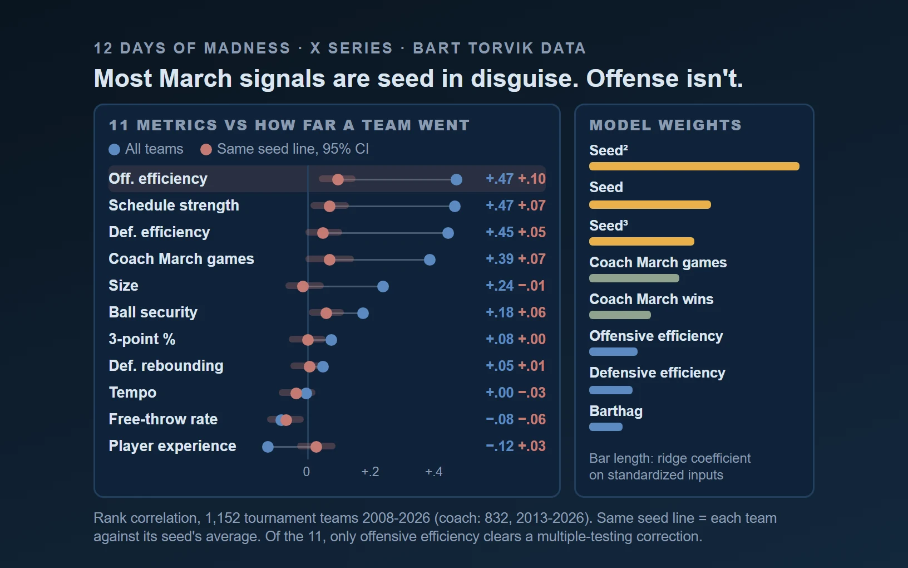

# March Madness (Men's) Analysis and Prediction

Predicts how far each NCAA Men's tournament team advances (round 0 to 6) from [Bart Torvik](https://barttorvik.com) team stats, 2008-2025 (2020 excluded, no tournament). Seed is the dominant signal, so the models and the analyses are built around separating what seed already explains from what it does not.

## What it found

- **Strength of schedule adds little once seed is known.** Centering each team against its seed line's average finish and average Elite SOS leaves a within-seed Spearman correlation of 0.061 ([report](reports/sos_vs_finish_pooled_summary.md)). The broad pooled gradient is mostly seed structure.
- **Where a stat matters depends on the seed band.** Effective height correlates with finish by +0.108 for seeds 1-2 and -0.077 for seeds 7-8 ([report](reports/size_vs_finish_by_seed_group_summary.md)). The same seed-band split is run for experience, three-point shooting, turnovers, rebounding, tempo and free-throw rate (see `reports/`).
- **Conference context beats raw SOS for finding seed-relative overperformers.** Mean overperformance against seed expectation runs from +0.420 (Horz) to -0.342 (MWC) ([report](reports/sos_conf_vs_overperformance_summary.md)).

## Analysis examples



Descriptive analysis of tournament results, showing how statistical relationships change within seed lines. The model-validation status is documented below.

Illustrated topic analyses: [analysis briefs](reports/briefs/README.md).

## Validation

The modeling table is 5,971 team-seasons by 122 columns, of which 1,088 are tournament teams with a seed and a result. `scripts/run_analysis.py` compares feature sets and algorithms with cross-validation and leave-one-out, then scores a blind 2025 holdout (64 teams).

The validation pipeline excludes result-derived features, including `PAKE` and `PASE`. `PAKE` and `PASE` are tournament wins minus expectation, so they are computed from the result being predicted. After residualizing the target against seed, `PASE` correlates 0.9948 and `PAKE` 0.9553 with it, against 0.0580 for `AdjOE` as a clean control. They are now excluded from every feature set, and `assert_no_target_leakage()` checks each set before it is fitted.

**Every metric in the earlier reports is void**, including `reports/predictive_analysis_20260304.md` and `reports/predictive_analysis_20260306.md` (the 0.060 holdout MAE on a 0-6 target) and the two `models/analysis_best_model_*.joblib` files. They are kept as history. A re-run after the fix has not been committed yet, so there is no valid headline accuracy number here. Details: commit b117223 and `docs/modeling_plan.md`.

## Models

- **General model**: ridge regression on `round` using efficiency (AdjOE, AdjDE, Barthag), seed, roster and coach-experience features. Its output, `predround`, feeds the seed models.
- **14 seed-stratified models**: each trains on a 2-3 seed band and takes `predround` as a feature.
- **Bracket simulation**: a Bradley-Terry model turns `predround` into pairwise win probabilities, and a Monte Carlo run (10,000 simulations by default) gives per-team odds for each round. See `src/models/`.
- **Analysis script**: `scripts/run_analysis.py` adds gradient boosting, random forest, lasso and elastic net, plus VIF and holdout reports.

Full design and roadmap: [docs/modeling_plan.md](docs/modeling_plan.md). Walk-forward validation by year is on the roadmap, not built.

## Run it

```bash
pip install -r requirements.txt
python scripts/run_pipeline.py                   # ingest, features, models, training CSV
python scripts/run_pipeline.py --data-only       # skip modeling
python scripts/run_pipeline.py --bracket data/external/templates/bracket_template.csv --n-sims 20000 --k 1.0
python scripts/run_analysis.py --holdout-year 2025
pytest
```

An R version of the pipeline is also here: `Rscript scripts/install_deps.R`, then `Rscript scripts/run_pipeline.R`.

Per-topic analyses (SOS, size, experience, three-point, turnovers, rebounding, tempo, free-throw rate) are scripts named `scripts/<topic>_analysis_*.py` and `scripts/build_<topic>_sample.py`. They write tables and summaries to `reports/`.

## Data

| Source | Notes |
|--------|-------|
| Bart Torvik | Per-year team tables, postseason tables, and `team-history.php` (coach, seed, finish, conference, coach 5-year stats). Assembled into `data/raw/assembled/all_trank_team_tables.csv`. |
| Clean training set | `data/processed/cbb_training_clean.csv`, written by the pipeline. |
| Optional external files | `data/external/`, see [docs/data_sources.md](docs/data_sources.md). Missing optional columns are filled with 0. |

Lineage: [docs/data_lineage.md](docs/data_lineage.md). Paths, year range and model settings live in `configs/default.yaml`.

## Known limitations

- No post-fix accuracy number is committed yet (see above).
- `src/ingestion/`, `src/features/`, `src/modeling/` and `src/evaluation/` are empty placeholders; the logic lives in `src/pipelines/madness.py` and `scripts/`.
- Seed-band analyses split about 136 teams per band, so single-band correlations of 0.1 or less are weak evidence.
- `bart_injuryimpact` is exploratory and needs the optional `toRvik` R package.

## Layout

```
configs/      pipeline settings
data/         raw, processed and external data
docs/         modeling plan, lineage, data sources, naming conventions
models/       joblib artifacts (pre-fix, see above)
reports/      analysis summaries and tables
scripts/      pipeline entry points, per-topic analyses, run_analysis.py
src/          pipelines/madness.py (and .R), models/ (bracket, win probability, simulation)
tests/        pytest suite
```

## More projects

More of my work and contact details are at [twhite.dev](https://twhite.dev).
