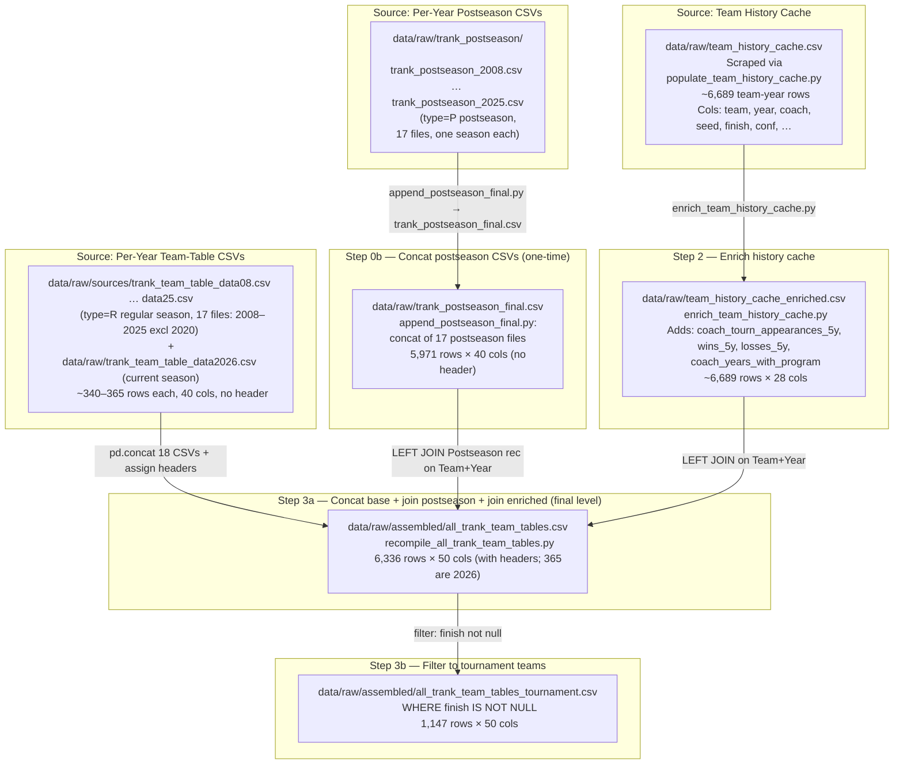

# Data Lineage: Raw Data Prep Pipeline

How `all_trank_team_tables.csv` and `all_trank_team_tables_tournament.csv` are assembled from raw sources.

---

## Run Order

```bash
# Step 0 (rare): Fetch per-year team-table CSVs from Bart Torvik
python scripts/fetch_team_tables.py

# Step 0b (rare): Rebuild the postseason concat from data/raw/trank_postseason/trank_postseason_YYYY.csv
python scripts/append_postseason_final.py

# Step 1 (rare): Populate team-history cache from Bart Torvik team-history.php
python scripts/populate_team_history_cache.py

# Step 2: Enrich cache with coach tournament experience
python scripts/enrich_team_history_cache.py

# Step 3: Recompile everything into final tables
python scripts/recompile_all_trank_team_tables.py

# Or run steps 2-3 together via the pipeline runner:
python scripts/run_pipeline.py --prep-raw
```

---

## Diagram



---

## Source Files

| File | Location | Source | Rows | Key Columns |
|------|----------|--------|------|-------------|
| `trank_team_table_data08.csv` … `data25.csv` | `data/raw/sources/` | Bart Torvik team-tables_each.php (type=R) | ~340–365/yr | Team through Elite SOS (40 cols, no header) |
| `trank_team_table_data2026.csv` | `data/raw/` | Bart Torvik team-tables_each.php, current season | 365 | Same layout |
| `trank_postseason_YYYY.csv` (2008–2025, no 2020) | `data/raw/trank_postseason/` | Bart Torvik team-tables_each.php (type=P) | ~340–365/yr | Same layout; col 5 = postseason W–L. One season per file; `append_postseason_final.py` skips a file whose `YEAR` column does not match its name |
| `team_history_cache.csv` | `data/raw/` | `populate_team_history_cache.py` | ~6,689 | team, year, coach, seed, finish, conf, … |

## Derived Files

| File | Location | How Built | Rows | Columns |
|------|----------|-----------|------|---------|
| `trank_postseason_final.csv` | `data/raw/` | `append_postseason_final.py` (concat of 17 postseason CSVs, dedupe on Team+Year) | 5,971 | 40 (no header) |
| `team_history_cache_enriched.csv` | `data/raw/` | `enrich_team_history_cache.py` | 6,689 | 28 (original 24 + 4 experience) |
| `all_trank_team_tables.csv` | `data/raw/assembled/` | `recompile_all_trank_team_tables.py` (final output) | 6,336 (5,971 for 2008–2025 + 365 for 2026) | 50 (with header) |
| `all_trank_team_tables_tournament.csv` | `data/raw/assembled/` | Same script, filtered `finish IS NOT NULL` | 1,147 | 50 (with header) |
| `trank_team_table_data2026_enriched.csv` | `data/raw/assembled/` | Same script, `Year == 2026` slice | 365 | 50 (with header) |

## Column Order (all_trank_team_tables.csv)

```
Team, Adj OE, Adj DE, Barthag, Record, Wins, Games,
eFG, eFG D., FT Rate, FT Rate D, TOV%, TOV% D, O Reb%, Op OReb%,
Raw T, 2P %, 2P % D., 3P %, 3P % D., Blk %, Blked %, Ast %, Op Ast %,
3P Rate, 3P Rate D, Adj. T, Avg Hgt., Eff. Hgt., Exp.,
Year,                             ← from regular-season base
PAKE, PASE, Talent, (blank),
FT%, Op. FT%, PPP Off., PPP Def., Elite SOS,
Postseason rec,                   ← joined from trank_postseason_final
coach, seed, finish, conf,        ← joined from team_history_cache_enriched
coach_tourn_appearances_5y,       ← enriched cache
coach_tourn_wins_5y,
coach_tourn_losses_5y,
coach_years_with_program,
conf_avg_barthag                  ← mean Barthag by (conf, Year), computed in recompile
```

## Join Keys

All joins use **Team + Year** (left join, preserving every row in the base table).

## Validation (64/68 team checks)

After assembly, every year should have:
- **65** tournament teams (2008–2010, pre-play-in) or **68** (2011–2025)
- Exactly **64** teams with `finish != R68` in every year
- 100% of tournament teams matched with coach, seed, finish, and experience columns

Run the checks:
```bash
python scripts/check_missing_seeds.py
```

## Known Gaps

2008–2010 have 65 tournament teams (pre-play-in era, only 1 play-in game = 65 not 68). Coach coverage is near-complete: 5 total missing coaches across all years.
