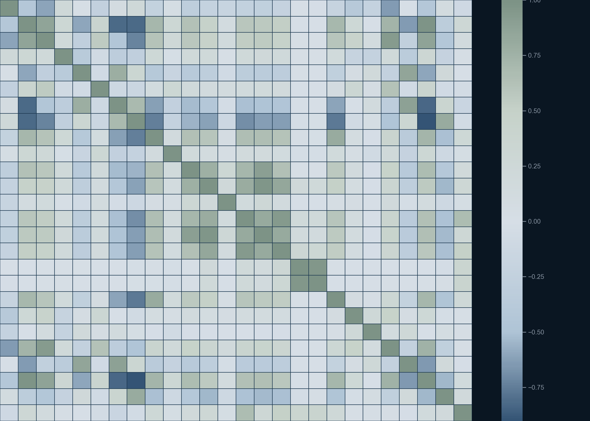
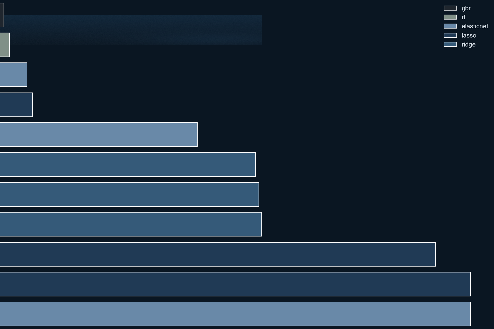
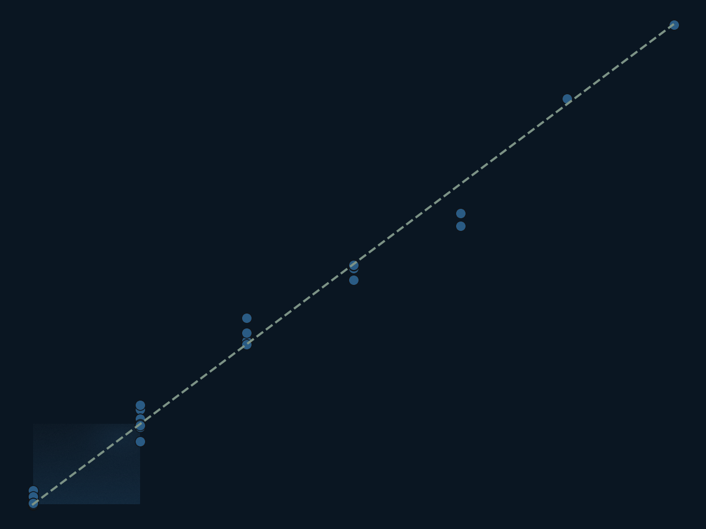
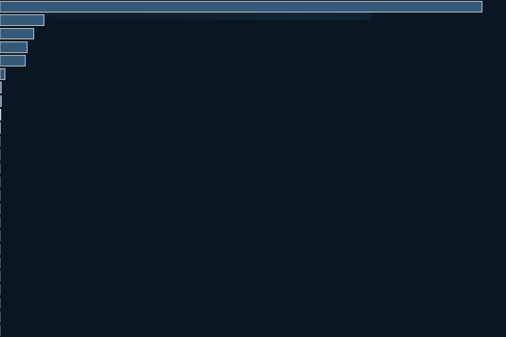

# Predictive Analysis Report (20260306)

> **VOID.** Every metric here comes from feature sets that contained `PAKE`/`PASE`, which are tournament wins minus expectation and so are computed from the target (fixed in commit b117223). The CV also split teams from the same bracket across folds. Kept as history only; current numbers are in `reports/predictive_analysis_20261025.md`.

## Run Configuration
- input_csv: `data/processed/cbb_training_clean.csv`
- holdout_year: `2025`
- cv_folds_requested: `3`
- search_depth: `fast`
- random_state: `42`

## Section 1: Data Profile
- dataset_shape: `5971 rows x 122 columns`
- year_range: `2008-2025`
- tournament_rows (seed+round non-null): `1088`
- non_tournament_rows: `4883`
- modeled_rows_excluding_2020: `1088`
- pre_holdout_rows (<2025): `1024`
- holdout_rows (2025): `64`

### Distribution Summary
| feature | mean | std | min | 25% | 50% | 75% | max |
| --- | --- | --- | --- | --- | --- | --- | --- |
| AdjOE | 102.8510 | 7.4716 | 72.1000 | 97.8000 | 102.5000 | 107.7000 | 129.5000 |
| AdjDE | 102.8534 | 6.5015 | 81.8000 | 98.3000 | 103.0000 | 107.5000 | 125.3000 |
| Barthag | 0.4940 | 0.2565 | 0.0051 | 0.2781 | 0.4724 | 0.7155 | 0.9833 |
| seed | 8.7698 | 4.6715 | 1.0000 | 5.0000 | 9.0000 | 13.0000 | 16.0000 |
| round | 0.9844 | 1.3410 | 0.0000 | 0.0000 | 0.5000 | 1.2500 | 6.0000 |

### Missingness (candidate feature columns)

### Correlation Matrix

### Collinearity Note
- corr(Barthag, AdjOE) = `0.8594`, corr(Barthag, AdjDE) = `-0.8258`, corr(AdjOE, AdjDE) = `-0.4603`.
- Barthag is derived from offensive and defensive efficiency, so high multicollinearity is expected.

## Section 2: Baseline Evaluation (CV + LOO)
- baseline_feature_count: `20`
- baseline_best_alpha_by_cv: `10.0`
- baseline_cv_mse: `1.644462`
- baseline_cv_mae: `1.076167`
- baseline_cv_fold_mse_std: `0.084672`
- baseline_cv_effective_splits: `3`
- baseline_loo_mse: `1.638483`
- baseline_loo_mae: `1.076104`

### Baseline Alpha Grid
| alpha | cv_mse | cv_mae | cv_mse_std |
| --- | --- | --- | --- |
| 0.010000 | 1.656705 | 1.079121 | 0.060414 |
| 0.100000 | 1.654842 | 1.078679 | 0.062788 |
| 0.300000 | 1.652235 | 1.078031 | 0.066784 |
| 1.000000 | 1.648194 | 1.076954 | 0.073896 |
| 3.000000 | 1.645029 | 1.076158 | 0.080172 |
| 10.000000 | 1.644462 | 1.076167 | 0.084672 |
| 30.000000 | 1.651067 | 1.076693 | 0.086821 |

## Section 3: Feature Optimization
| feature_set | n_features | best_alpha | cv_mse | cv_mae | cv_mse_std | cv_splits | loo_mse | loo_mae |
| --- | --- | --- | --- | --- | --- | --- | --- | --- |
| baseline_plus_unused | 27 | 0.010000 | 0.974168 | 0.983569 | 0.002297 | 3 | 0.975635 | 0.984448 |
| kitchen_sink_numeric_no_leakage | 101 | 1.000000 | 1.000857 | 0.982878 | 0.019138 | 3 | 1.002152 | 0.984548 |
| raw_plus_rank | 43 | 0.010000 | 1.090934 | 0.982504 | 0.018177 | 3 | 1.099688 | 0.986337 |
| rank_only | 23 | 1.000000 | 1.188644 | 0.981556 | 0.059393 | 3 | inf | inf |
| baseline_raw_poly | 20 | 10.000000 | 1.644462 | 1.076167 | 0.084672 | 3 | inf | inf |
| engineered_interactions | 23 | 10.000000 | 1.645350 | 1.076433 | 0.082617 | 3 | inf | inf |
| drop_barthag_keep_adjoe_adjde | 18 | 3.000000 | 1.648411 | 1.077812 | 0.083538 | 3 | inf | inf |

- selected_feature_set: `baseline_plus_unused`
- selected_feature_count: `27`
- selected_ridge_alpha: `0.01`

### VIF (Top 20)
| feature | vif |
| --- | --- |
| seed_2 | 1486.4404 |
| coach_tourn_games_5y | 694.5035 |
| seed_3 | 561.3619 |
| coach_tourn_wins_5y | 400.1557 |
| seed | 348.0139 |
| Barthag_2 | 227.9658 |
| Barthag | 123.9076 |
| coach_tourn_appearances_5y | 66.2650 |
| AdjOE | 64.1868 |
| AdjDE | 59.8238 |
| AdjDE_2 | 41.8589 |
| PASE | 29.1797 |
| PAKE | 27.9484 |
| PPPOFF | 20.1210 |
| PPPDEF | 16.2824 |
| ELITESOS | 14.6424 |
| coach_avg_wins_per_appearance | 13.2454 |
| coach_tourn_win_pct_5y | 8.8108 |
| TALENT | 3.8606 |
| EFGD% | 2.9884 |

### Scaled Ridge Coefficients (Top 25)
| feature | coef | abs_coef |
| --- | --- | --- |
| seed_2 | 5.502789 | 5.502789 |
| seed | -3.450674 | 3.450674 |
| seed_3 | -2.771992 | 2.771992 |
| PASE | 0.837474 | 0.837474 |
| Barthag | -0.322468 | 0.322468 |
| AdjDE | -0.286669 | 0.286669 |
| PAKE | 0.211114 | 0.211114 |
| AdjOE | 0.176652 | 0.176652 |
| Barthag_2 | 0.166085 | 0.166085 |
| AdjDE_2 | 0.145977 | 0.145977 |
| coach_tourn_games_5y | -0.044130 | 0.044130 |
| coach_tourn_wins_5y | 0.038376 | 0.038376 |
| PPPOFF | -0.016239 | 0.016239 |
| coach_avg_wins_per_appearance | 0.014375 | 0.014375 |
| PPPDEF | -0.012227 | 0.012227 |
| TALENT | 0.007826 | 0.007826 |
| TOR | -0.007324 | 0.007324 |
| ORB | 0.006811 | 0.006811 |
| coach_tourn_appearances_5y | 0.006734 | 0.006734 |
| coach_tourn_win_pct_5y | -0.004517 | 0.004517 |
| OPFT% | 0.003867 | 0.003867 |
| FT% | 0.003533 | 0.003533 |
| ELITESOS | 0.002811 | 0.002811 |
| AST% | 0.002216 | 0.002216 |
| EFGD% | 0.002168 | 0.002168 |

## Section 4: Algorithm Search
| model_id | algorithm | params | cv_mse | cv_mae | cv_mse_std | cv_splits | loo_mse | loo_mae |
| --- | --- | --- | --- | --- | --- | --- | --- | --- |
| 10 | gbr | n_estimators=100, max_depth=3, learning_rate=0.1 | 0.014542 | 0.061793 | 0.003738 | 3 | inf | inf |
| 11 | rf | n_estimators=100, max_depth=5 | 0.036390 | 0.098075 | 0.004476 | 3 | inf | inf |
| 7 | elasticnet | alpha=0.1, l1_ratio=0.5 | 0.103439 | 0.225113 | 0.007960 | 3 | 0.103370 | 0.225399 |
| 4 | lasso | alpha=0.1 | 0.123554 | 0.234165 | 0.008657 | 3 | 0.123380 | 0.234195 |
| 8 | elasticnet | alpha=1.0, l1_ratio=0.5 | 0.754017 | 0.645207 | 0.031336 | 3 | 0.757688 | 0.645403 |
| 1 | ridge | alpha=0.1 | 0.975764 | 0.983683 | 0.005159 | 3 | inf | inf |
| 2 | ridge | alpha=1.0 | 0.988811 | 0.983824 | 0.011153 | 3 | inf | inf |
| 3 | ridge | alpha=10.0 | 0.999557 | 0.983133 | 0.012616 | 3 | inf | inf |
| 5 | lasso | alpha=1.0 | 1.663311 | 0.950925 | 0.027131 | 3 | inf | inf |
| 6 | lasso | alpha=10.0 | 1.796640 | 0.984372 | 0.027951 | 3 | inf | inf |
| 9 | elasticnet | alpha=10.0, l1_ratio=0.5 | 1.796640 | 0.984372 | 0.027951 | 3 | inf | inf |

- winning_algorithm: `gbr`
- winning_params: `n_estimators=100, max_depth=3, learning_rate=0.1`
- winning_cv_mse: `0.014542`
- winning_cv_mae: `0.061793`

## Section 5: Holdout + Final Retrain
- holdout_year: `2025`
- holdout_mse: `0.012803`
- holdout_mae: `0.060167`
- holdout_rows_scored: `64`
- final_retrain_rows: `1088`
- model_artifact: `models\analysis_best_model_20260306.joblib`

### Holdout Prediction Table
| Team | year | seed | actual_round | pred_round |
| --- | --- | --- | --- | --- |
| Mount St. Mary's | 2025 | 16.0000 | 0.0000 | 0.0111 |
| Auburn | 2025 | 1.0000 | 4.0000 | 3.4793 |
| Duke | 2025 | 1.0000 | 4.0000 | 3.6321 |
| Alabama | 2025 | 2.0000 | 3.0000 | 2.9488 |
| Florida | 2025 | 1.0000 | 6.0000 | 5.9877 |
| Missouri | 2025 | 6.0000 | 0.0000 | 0.0536 |
| Texas Tech | 2025 | 3.0000 | 3.0000 | 2.8019 |
| Purdue | 2025 | 4.0000 | 2.0000 | 2.0430 |
| Houston | 2025 | 1.0000 | 5.0000 | 5.0679 |
| BYU | 2025 | 6.0000 | 2.0000 | 2.0138 |
| Kentucky | 2025 | 3.0000 | 2.0000 | 2.0597 |
| Gonzaga | 2025 | 8.0000 | 1.0000 | 1.1864 |
| Arizona | 2025 | 4.0000 | 2.0000 | 2.0370 |
| Wisconsin | 2025 | 3.0000 | 1.0000 | 0.9731 |
| Illinois | 2025 | 6.0000 | 1.0000 | 1.0340 |
| Utah St. | 2025 | 10.0000 | 0.0000 | -0.0109 |
| Connecticut | 2025 | 8.0000 | 1.0000 | 1.0424 |
| Baylor | 2025 | 9.0000 | 1.0000 | 1.0645 |
| Iowa St. | 2025 | 3.0000 | 1.0000 | 1.0092 |
| Tennessee | 2025 | 2.0000 | 3.0000 | 2.9784 |
| Maryland | 2025 | 4.0000 | 2.0000 | 2.0386 |
| Mississippi St. | 2025 | 8.0000 | 0.0000 | 0.0310 |
| Vanderbilt | 2025 | 10.0000 | 0.0000 | 0.0128 |
| North Carolina | 2025 | 11.0000 | 0.0000 | 0.1006 |
| Louisville | 2025 | 8.0000 | 0.0000 | 0.1063 |

### Winner Feature Importance

| feature | importance |
| --- | --- |
| PASE | 1.299113 |
| seed_2 | 0.118518 |
| PAKE | 0.090628 |
| seed_3 | 0.073227 |
| seed | 0.068099 |
| Barthag | 0.013213 |
| coach_tourn_win_pct_5y | 0.003868 |
| coach_tourn_wins_5y | 0.003759 |
| coach_avg_wins_per_appearance | 0.002407 |
| Barthag_2 | 0.001020 |
| FT% | 0.000354 |
| OPFT% | 0.000142 |
| TOR | 0.000058 |
| coach_tourn_games_5y | 0.000054 |
| AST% | 0.000054 |
| AdjOE | 0.000033 |
| 3P% | 0.000025 |
| AdjDE_2 | 0.000020 |
| AdjDE | 0.000014 |
| PPPOFF | 0.000011 |
| PPPDEF | 0.000009 |
| EFGD% | 0.000009 |
| coach_years_with_program | 0.000006 |
| ORB | 0.000005 |
| ELITESOS | 0.000004 |

## Recommendation
Replace the current general model candidate with feature set `baseline_plus_unused` and algorithm `gbr` (n_estimators=100, max_depth=3, learning_rate=0.1), based on lowest pre-holdout CV MSE and confirmed holdout performance on 2025.