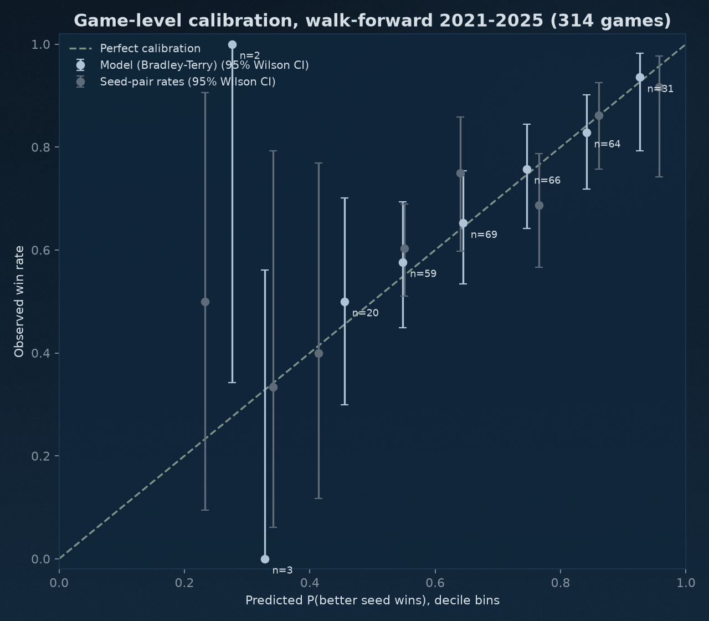

# Bracket Simulation 2025 (walk-forward 2021-2025)

> **Vintage note (added 2026-10-06; numbers below unchanged).** Run 2026-09-29 before the charter was locked,
> on an earlier training CSV (sha256 prefix `8565be043d11155d`) and game file (`504f855b2dac0ee1`), not the
> frozen inputs. Scoring this Barthag-heavy model on 2021-2025 is why the 2021-2026 test is not blind.
> Round probabilities here are post-First-Four and retrospective. Current result:
> `reports/model_vs_seeds_powered.md`. Reruns of `scripts/run_bracket_evaluation.py` write `_<out-tag>` files.

## Headline
- Over 314 tournament games in 5 walked-forward tournaments (2021-2025), the model's game-level Brier score is 0.1891 (log loss 0.5579) against 0.1940 (0.5697) for historical seed-pair win rates and 0.2874 (1.3234) for deterministic seed chalk.
- Brier(model) minus Brier(seed-pair rates) = -0.0049, 95% paired bootstrap interval [-0.0174, +0.0076]: the model is not distinguishable at this sample size.
- Brier(model) minus Brier(seed chalk) = -0.0984, 95% paired bootstrap interval [-0.1344, -0.0645]: the model is better at this sample size.
- Committed brackets, 2021-2025: Final Four hits model 10/20, seed-pair 8.5, chalk 9; champion hits model 0/5, seed-pair 0.875, chalk 1 (chalk ties between 1 seeds count as a coin flip).
- 2025 committed bracket: champion pick **Houston** (actual champion Florida); Final Four picks Florida, Auburn, Houston, Duke (actual Auburn, Duke, Florida, Houston).
- Calibration error (ECE, decile bins): model 0.0193, seed-pair 0.0569.
- Deterministic: simulation seed `123`, `10,000` simulations per bracket; the seed is also written into every `round_predictions_<year>.csv`.
- Stability gate (Build-Rebuild-and-Compare): **PASS** (0 feature-set change(s) across builds, k max/min 1.01).

## Run Configuration
- command: `python scripts/run_bracket_evaluation.py`
- code_revision: `2ce8199 + uncommitted changes`; training data `data/processed/cbb_training_clean.csv` (sha256 prefix `8565be043d11155d`)
- games: `data/raw/tournament_games.csv` from `https://barttorvik.com/YYYY_super_sked.json`, retrieved 2026-09-29T08:27:24+00:00, sha256 prefix `504f855b2dac0ee1`
- walk-forward tournaments: [2021, 2022, 2023, 2024, 2025] (2020 had no tournament). No 2026 rows exist in the processed training data at run time, so 2026 is not scored.
- simulation seed: `123`; n_sims: `10000`; bootstrap resamples: `10000`

## Method
- Prediction moment: the published bracket. The simulation starts at the Round of 64 with the First Four already played; First Four games are not scored.
- Team strength = predicted tournament wins from ridge on the feature set chosen by season-grouped CV on seasons before the tournament (`scripts/run_analysis.py`). The field is scored by `score_field()`, which deletes every outcome column (PASE, PAKE, round, result, finish and the rest of `OUTCOME_COLUMNS`) before building features; each build also asserts that no outcome column is in the selected feature list.
- P(A beats B) = 1 / (1 + exp(-k (strength_A - strength_B))). k is fit by maximum likelihood on earlier tournaments' games using out-of-fold strengths.
- Seed-pair baseline: P(better seed wins) from every earlier tournament game between the same two seeds, Laplace-smoothed ((wins + 1) / (games + 2)); equal seeds 0.5.
- Seed chalk: the better seed wins with certainty (Brier uses 1/0). For log loss a chalk pick is treated as 99% confident, because a hard pick has infinite log loss on any upset; a more confident chalk only scores worse.
- Game-level scores condition on the matchups that happened. The advancement table scores the pre-tournament simulated probability of reaching each round for all 64 teams.
- Committed bracket: the likelier winner of every game (by that method's head-to-head probability), filled from the Round of 64. Exact 50/50 picks are split, so hits are expected values.
- 2021 Oregon-VCU (no-contest, COVID) advances Oregon in the bracket and is not scored.

## Game-level Brier and log loss by round (pooled 2021-2025)
| round | round_name | n | brier_model | logloss_model | brier_seed_pair | logloss_seed_pair | brier_chalk | logloss_chalk |
| --- | --- | --- | --- | --- | --- | --- | --- | --- |
| 1 | R64 | 159 | 0.1751 | 0.5248 | 0.1768 | 0.5278 | 0.2830 | 1.3106 |
| 2 | R32 | 80 | 0.1735 | 0.5165 | 0.1889 | 0.5611 | 0.2875 | 1.3311 |
| 3 | S16 | 40 | 0.2643 | 0.7492 | 0.2616 | 0.7260 | 0.3750 | 1.7332 |
| 4 | E8 | 20 | 0.1886 | 0.5561 | 0.2227 | 0.6362 | 0.2500 | 1.1588 |
| 5 | F4 | 10 | 0.1777 | 0.5337 | 0.1829 | 0.5503 | 0.1500 | 0.6062 |
| 6 | Final | 5 | 0.3029 | 0.7968 | 0.1884 | 0.5587 | 0.1500 | 0.4199 |
| all | all | 314 | 0.1891 | 0.5579 | 0.1940 | 0.5697 | 0.2874 | 1.3234 |

### By tournament
| year | n | brier_model | logloss_model | brier_seed_pair | logloss_seed_pair | brier_chalk | logloss_chalk |
| --- | --- | --- | --- | --- | --- | --- | --- |
| 2021 | 62 | 0.2034 | 0.5817 | 0.2080 | 0.6037 | 0.3105 | 1.4292 |
| 2022 | 63 | 0.2036 | 0.5993 | 0.2056 | 0.5908 | 0.3333 | 1.5418 |
| 2023 | 63 | 0.2222 | 0.6485 | 0.2106 | 0.6229 | 0.3016 | 1.3959 |
| 2024 | 63 | 0.1832 | 0.5415 | 0.1909 | 0.5566 | 0.3056 | 1.4067 |
| 2025 | 63 | 0.1331 | 0.4186 | 0.1551 | 0.4749 | 0.1865 | 0.8449 |

## Pre-tournament advancement probabilities by round (64 teams per tournament)
| round | round_reached | n | brier_model | logloss_model | brier_seed_pair | logloss_seed_pair | brier_chalk | logloss_chalk |
| --- | --- | --- | --- | --- | --- | --- | --- | --- |
| 1 | R32 | 320 | 0.1749 | 0.5242 | 0.1770 | 0.5286 | 0.2812 | 1.3024 |
| 2 | S16 | 320 | 0.1237 | 0.3906 | 0.1321 | 0.4140 | 0.1875 | 0.8716 |
| 3 | E8 | 320 | 0.0889 | 0.2953 | 0.0917 | 0.3072 | 0.1375 | 0.6419 |
| 4 | F4 | 320 | 0.0454 | 0.1726 | 0.0484 | 0.1776 | 0.0688 | 0.3260 |
| 5 | Final | 320 | 0.0233 | 0.0932 | 0.0249 | 0.0971 | 0.0247 | 0.0952 |
| 6 | Champion | 320 | 0.0157 | 0.0556 | 0.0135 | 0.0534 | 0.0133 | 0.0554 |

## Calibration

Each game is oriented to the better seed (equal seeds: alphabetical), so the x axis is P(better seed wins). Intervals are 95% Wilson intervals; late-round bins are thin.

### Model
| bin | n | mean_pred | observed | ci_low | ci_high |
| --- | --- | --- | --- | --- | --- |
| 0.0-0.1 | 0 |  |  |  |  |
| 0.1-0.2 | 0 |  |  |  |  |
| 0.2-0.3 | 2 | 0.284 | 1.000 | 0.342 | 1.000 |
| 0.3-0.4 | 3 | 0.336 | 0.000 | 0.000 | 0.562 |
| 0.4-0.5 | 20 | 0.464 | 0.500 | 0.299 | 0.701 |
| 0.5-0.6 | 59 | 0.556 | 0.576 | 0.449 | 0.694 |
| 0.6-0.7 | 69 | 0.653 | 0.652 | 0.534 | 0.754 |
| 0.7-0.8 | 66 | 0.754 | 0.758 | 0.642 | 0.845 |
| 0.8-0.9 | 64 | 0.850 | 0.828 | 0.718 | 0.901 |
| 0.9-1.0 | 31 | 0.934 | 0.935 | 0.793 | 0.982 |

### Seed-pair rates
| bin | n | mean_pred | observed | ci_low | ci_high |
| --- | --- | --- | --- | --- | --- |
| 0.0-0.1 | 0 |  |  |  |  |
| 0.1-0.2 | 0 |  |  |  |  |
| 0.2-0.3 | 2 | 0.225 | 0.500 | 0.095 | 0.905 |
| 0.3-0.4 | 3 | 0.333 | 0.333 | 0.061 | 0.792 |
| 0.4-0.5 | 5 | 0.406 | 0.400 | 0.118 | 0.769 |
| 0.5-0.6 | 111 | 0.542 | 0.604 | 0.511 | 0.690 |
| 0.6-0.7 | 40 | 0.632 | 0.750 | 0.598 | 0.858 |
| 0.7-0.8 | 64 | 0.757 | 0.688 | 0.566 | 0.788 |
| 0.8-0.9 | 65 | 0.853 | 0.862 | 0.757 | 0.925 |
| 0.9-1.0 | 24 | 0.949 | 0.917 | 0.742 | 0.977 |

## Committed-bracket hits
| year | method | final_four_hits | champion_hit | correct_R64 | espn_points |
| --- | --- | --- | --- | --- | --- |
| 2021 | Model (Bradley-Terry) | 3.00 | 0.00 | 25.00 | 1090.00 |
| 2021 | Seed-pair rates | 1.50 | 0.12 | 22.00 | 760.00 |
| 2021 | Seed chalk | 2.00 | 0.25 | 22.00 | 920.00 |
| 2022 | Model (Bradley-Terry) | 1.00 | 0.00 | 24.00 | 800.00 |
| 2022 | Seed-pair rates | 1.00 | 0.25 | 22.00 | 780.00 |
| 2022 | Seed chalk | 1.00 | 0.25 | 22.00 | 780.00 |
| 2023 | Model (Bradley-Terry) | 0.00 | 0.00 | 24.00 | 480.00 |
| 2023 | Seed-pair rates | 0.00 | 0.00 | 24.00 | 460.00 |
| 2023 | Seed chalk | 0.00 | 0.00 | 25.00 | 470.00 |
| 2024 | Model (Bradley-Terry) | 2.00 | 0.00 | 21.00 | 750.00 |
| 2024 | Seed-pair rates | 2.00 | 0.25 | 21.00 | 970.00 |
| 2024 | Seed chalk | 2.00 | 0.25 | 21.00 | 970.00 |
| 2025 | Model (Bradley-Terry) | 4.00 | 0.00 | 23.00 | 1270.00 |
| 2025 | Seed-pair rates | 4.00 | 0.25 | 24.00 | 1320.00 |
| 2025 | Seed chalk | 4.00 | 0.25 | 25.00 | 1330.00 |

### Totals
| method | final_four_hits | champion_hit | correct_R64 | espn_points |
| --- | --- | --- | --- | --- |
| Model (Bradley-Terry) | 10.00 | 0.00 | 117.00 | 4390.00 |
| Seed-pair rates | 8.50 | 0.88 | 113.00 | 4290.00 |
| Seed chalk | 9.00 | 1.00 | 115.00 | 4470.00 |

## Committed 2025 bracket (model)
Regions are rebuilt from the games and named by their 1 seed; national semifinal pairings are A-B and C-D. Strengths from the model trained on 2008-2024, k = 0.813.

| round | pick | seed | region | won |
| --- | --- | --- | --- | --- |
| R64 | Florida | 1 | A (Florida region) | yes |
| R64 | Oklahoma | 9 | A (Florida region) | no |
| R64 | Memphis | 5 | A (Florida region) | no |
| R64 | Maryland | 4 | A (Florida region) | yes |
| R64 | Missouri | 6 | A (Florida region) | no |
| R64 | Texas Tech | 3 | A (Florida region) | yes |
| R64 | Kansas | 7 | A (Florida region) | no |
| R64 | St. John's | 2 | A (Florida region) | yes |
| R64 | Auburn | 1 | B (Auburn region) | yes |
| R64 | Louisville | 8 | B (Auburn region) | no |
| R64 | Michigan | 5 | B (Auburn region) | yes |
| R64 | Texas A&M | 4 | B (Auburn region) | yes |
| R64 | North Carolina | 11 | B (Auburn region) | no |
| R64 | Iowa St. | 3 | B (Auburn region) | yes |
| R64 | Marquette | 7 | B (Auburn region) | no |
| R64 | Michigan St. | 2 | B (Auburn region) | yes |
| R64 | Houston | 1 | C (Houston region) | yes |
| R64 | Gonzaga | 8 | C (Houston region) | yes |
| R64 | Clemson | 5 | C (Houston region) | no |
| R64 | Purdue | 4 | C (Houston region) | yes |
| R64 | Illinois | 6 | C (Houston region) | yes |
| R64 | Kentucky | 3 | C (Houston region) | yes |
| R64 | UCLA | 7 | C (Houston region) | yes |
| R64 | Tennessee | 2 | C (Houston region) | yes |
| R64 | Duke | 1 | D (Duke region) | yes |
| R64 | Mississippi St. | 8 | D (Duke region) | no |
| R64 | Oregon | 5 | D (Duke region) | yes |
| R64 | Arizona | 4 | D (Duke region) | yes |
| R64 | BYU | 6 | D (Duke region) | yes |
| R64 | Wisconsin | 3 | D (Duke region) | yes |
| R64 | Saint Mary's | 7 | D (Duke region) | yes |
| R64 | Alabama | 2 | D (Duke region) | yes |
| R32 | Florida | 1 | A (Florida region) | yes |
| R32 | Maryland | 4 | A (Florida region) | yes |
| R32 | Texas Tech | 3 | A (Florida region) | yes |
| R32 | St. John's | 2 | A (Florida region) | no |
| R32 | Auburn | 1 | B (Auburn region) | yes |
| R32 | Texas A&M | 4 | B (Auburn region) | no |
| R32 | Iowa St. | 3 | B (Auburn region) | no |
| R32 | Michigan St. | 2 | B (Auburn region) | yes |
| R32 | Houston | 1 | C (Houston region) | yes |
| R32 | Purdue | 4 | C (Houston region) | yes |
| R32 | Kentucky | 3 | C (Houston region) | yes |
| R32 | Tennessee | 2 | C (Houston region) | yes |
| R32 | Duke | 1 | D (Duke region) | yes |
| R32 | Arizona | 4 | D (Duke region) | yes |
| R32 | Wisconsin | 3 | D (Duke region) | no |
| R32 | Alabama | 2 | D (Duke region) | yes |
| S16 | Florida | 1 | A (Florida region) | yes |
| S16 | Texas Tech | 3 | A (Florida region) | yes |
| S16 | Auburn | 1 | B (Auburn region) | yes |
| S16 | Michigan St. | 2 | B (Auburn region) | yes |
| S16 | Houston | 1 | C (Houston region) | yes |
| S16 | Tennessee | 2 | C (Houston region) | yes |
| S16 | Duke | 1 | D (Duke region) | yes |
| S16 | Alabama | 2 | D (Duke region) | yes |
| E8 | Florida | 1 | A (Florida region) | yes |
| E8 | Auburn | 1 | B (Auburn region) | yes |
| E8 | Houston | 1 | C (Houston region) | yes |
| E8 | Duke | 1 | D (Duke region) | yes |
| F4 | Auburn | 1 | B (Auburn region) | no |
| F4 | Houston | 1 | C (Houston region) | yes |
| Final | Houston | 1 | C (Houston region) | no |

### Title probabilities, top 8 (simulated)
| Team | Seed | p_F4 | p_Finals | p_Champ | expected_round | actual_wins |
| --- | --- | --- | --- | --- | --- | --- |
| Houston | 1 | 0.707 | 0.488 | 0.349 | 4.223 | 5 |
| Auburn | 1 | 0.639 | 0.443 | 0.210 | 3.902 | 4 |
| Duke | 1 | 0.599 | 0.315 | 0.204 | 3.763 | 4 |
| Florida | 1 | 0.536 | 0.289 | 0.113 | 3.436 | 6 |
| Alabama | 2 | 0.234 | 0.079 | 0.037 | 2.619 | 3 |
| Tennessee | 2 | 0.123 | 0.044 | 0.016 | 2.184 | 3 |
| St. John's | 2 | 0.138 | 0.048 | 0.011 | 2.025 | 1 |
| Michigan St. | 2 | 0.124 | 0.049 | 0.010 | 2.028 | 3 |

## Round prediction walked forward (MSE and MAE on 0-6 wins)
Model strength as predicted wins against the historical mean wins for the same seed, both fit on seasons before the tournament.

| year | model_mse | seed_lookup_mse | model_mae | seed_lookup_mae |
| --- | --- | --- | --- | --- |
| 2021 | 1.0995 | 1.2466 | 0.7881 | 0.8451 |
| 2022 | 1.2950 | 1.2932 | 0.8038 | 0.7831 |
| 2023 | 1.6114 | 1.7374 | 0.8765 | 0.8817 |
| 2024 | 1.0153 | 0.9420 | 0.7229 | 0.6927 |
| 2025 | 0.5441 | 0.5839 | 0.5550 | 0.5874 |
| mean | 1.1131 | 1.1606 | 0.7493 | 0.7580 |

## Stability gate (Build-Rebuild-and-Compare)
Each tournament's build repeats the same selection on earlier seasons only. Rule: pass if the selected feature set changes at most once and k stays within a 1.5x band; nothing was re-tuned after seeing a held-out tournament.

| year | train_seasons | feature_set | n_features | ridge_alpha | cv_mse | k |
| --- | --- | --- | --- | --- | --- | --- |
| 2021 | 2008-2020 (no 2020) | baseline_raw_poly | 20 | 0.0100 | 1.0420 | 0.8149 |
| 2022 | 2008-2021 (no 2020) | baseline_raw_poly | 20 | 0.0100 | 1.0407 | 0.8119 |
| 2023 | 2008-2022 (no 2020) | baseline_raw_poly | 20 | 0.0100 | 1.0578 | 0.8075 |
| 2024 | 2008-2023 (no 2020) | baseline_raw_poly | 20 | 0.1000 | 1.0955 | 0.8142 |
| 2025 | 2008-2024 (no 2020) | baseline_raw_poly | 20 | 0.1000 | 1.0890 | 0.8130 |

## Caveats
- 5 tournaments is a small sample: 15 Final Four and title games in total, so late-round and champion comparisons are anecdotes, not evidence.
- The bracket is scored from the Round of 64; First Four uncertainty is not modeled.
- Strength comes from a regression on tournament wins, a noisy target; a matchup model fit directly on game outcomes is the natural next candidate.
