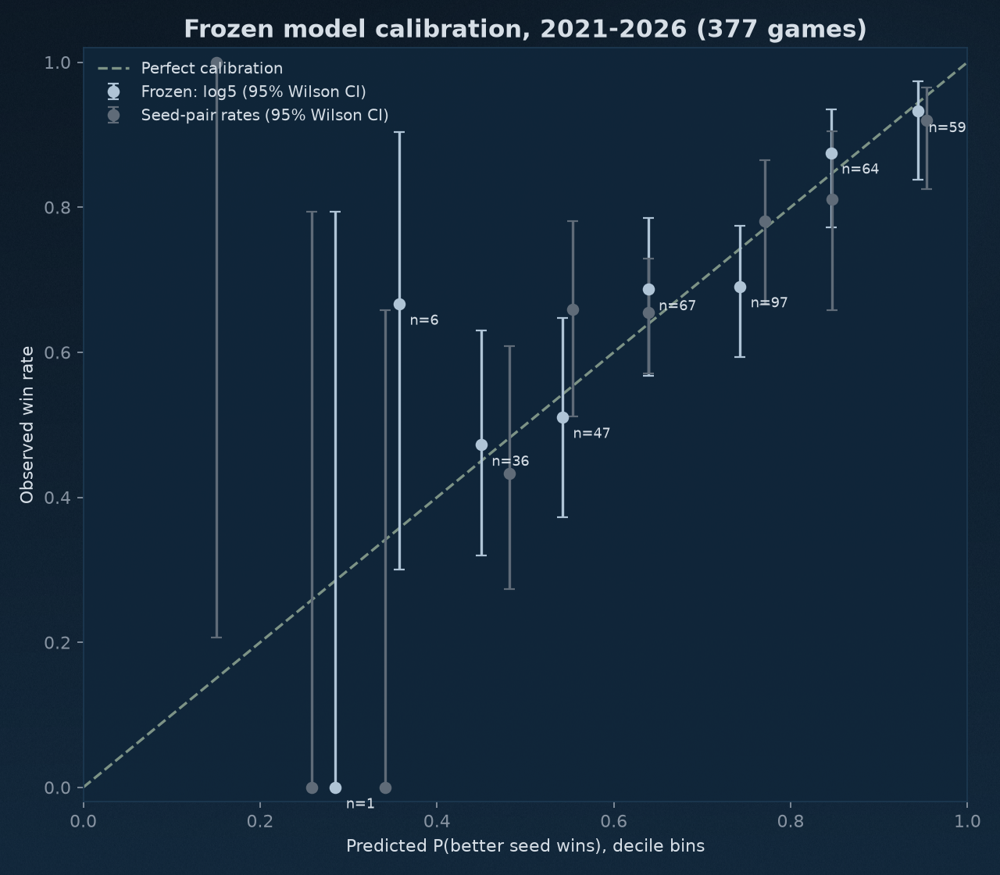

# Model vs seed-pair rates: powered walk-forward test, 2010-2026

## Executive result
- **Existing model, every tournament 2010-2026 (16 tournaments, 1007 games):** No detectable edge for the model over 16 tournaments: Brier difference -0.0020 [-0.0087, +0.0059] (model minus seed-pair), log loss -0.0048 [-0.0252, +0.0194]. The test could have detected an edge of 0.0117 Brier (0.0358 log loss) with 80% power; its power against the 0.005 Brier edge fixed in advance was 21%.
- **Frozen game-level model, 2021-2026 (6 tournaments, 377 games, scored once):** `log5`, chosen on 2010-2019 only and frozen at 2026-09-29T16:22:27+00:00. No detectable edge for the frozen model over 2021-2026: Brier difference -0.0059 [-0.0123, +0.0004] (model minus seed-pair), log loss -0.0190 [-0.0392, +0.0012]. The test could have detected an edge of 0.0126 Brier (0.0399 log loss) with 80% power; its power against the 0.005 Brier edge fixed in advance was 15%.
- **External reference:** T-Rank's archived pregame line, 2015-2026 (11 tournaments, 692 games), minus seed-pair: Brier -0.0085 [-0.0137, -0.0033]. It is published the day of each game, so from the Round of 32 on it has seen earlier tournament games: a ceiling, not a like-for-like rival.
- **Path-aware round probabilities** (each team's chance of reaching each round, summed over the opponents it could meet in the real bracket): existing model minus seed-pair, 2010-2026, Brier -0.0021 [-0.0040, -0.0000]; frozen model minus seed-pair, 2021-2026, Brier -0.0035 [-0.0071, +0.0007].
- **Trevor's earlier models:** the madness.py seed-stratified family (intercept restored) minus seed-pair, 2010-2026, Brier +0.0021 [-0.0075, +0.0122]. His 2025 notebook forecasts are scored on 2025 only (Section 6).
- **Search correction on the selection years:** 28 variants tried on 2010-2019. Chosen variant vs seed-pair there: raw p 0.053, Sidak-adjusted p 0.782, White's Reality Check p 0.099. The 2021-2026 test is one pre-registered comparison, so its p needs no search correction.

### Publishable claim
> Across 1007 NCAA tournament games from 2010 to 2026, the model's win probabilities were no more accurate than historical seed-pair rates (Brier difference -0.002, 95% CI -0.009 to +0.006); the test could have detected an edge of 0.012.

## Question and locked charter
Locked at 2026-09-29T16:11:27+00:00 before any fit; the selection froze at 2026-09-29T16:22:27+00:00.

- question: Do pre-tournament win probabilities beat historical seed-pair win rates on NCAA men's tournament games, and by how much, with enough power to answer either way?
- grain: one row per tournament game from the Round of 64 on, oriented to the better seed (equal seeds: alphabetical); First Four excluded; 2021 Oregon-VCU no-contest excluded
- decision time: the published bracket on Selection Sunday, before any tournament game
- target: a_won = 1 if the better-seeded team won
- inputs: Torvik regular-season team table (type R) and bracket seed only; outcome columns (PASE, PAKE, round, finish, postseason record) are excluded by the prediction-time contract
- baselines: null coin flip 0.5; constant = training-fold better-seed win rate; chalk at 0.70 and 0.99; historical seed-pair rates 1985 to Y-1 (the baseline that matters); external: T-Rank archived pregame line
- primary metric: Brier score (0-1 scale), lower is better; secondary: log loss
- selection: walk-forward 2010-2019 only; lowest pooled Brier among model candidates (seed-pair logged as reference, never frozen), log loss breaks ties; every variant logged
- test: walk-forward 2021-2026, scored once for the single frozen candidate
- uncertainty: paired per-game loss difference; year-block bootstrap 95% CI (10,000 resamples, seed 123); Diebold-Mariano t with year-clustered variance; n_eff cross-check
- acceptance: the frozen model beats seed-pair rates if the 2021-2026 year-block 95% CI on Brier(frozen) - Brier(seed-pair) lies entirely below 0; otherwise report no detectable edge with the MDE
- meaningful edge: 0.005 Brier, 0.015 log loss
- allowed reruns: none of the selection after the frozen file exists; the score stage is deterministic

## Data
- Games: 1007 scored games in 16 tournaments 2010-2026 (2020 cancelled), 63 per year except 2021 (62: Oregon-VCU no-contest). Torvik `YYYY_super_sked.json`, cross-checked against recorded wins every season (`data/raw/tournament_games_manifest.json`).
- Seed-pair history: 1985-2007 from Sports Reference (`data/raw/seed_history_games_manifest.json`; parser matched Torvik game for game on 2008 and 2019), 2008 on from Torvik.
- T-Rank archived pregame line: 692 of the scored games (every game 2015-2026).
- Team inputs: Torvik regular-season table (type R, games through the conference tournaments) and bracket seed; 2026 from the 2026-03-05 export, which predates the conference tournaments: 2026 tournament teams have a median 30 games against 32-33 in 2022-2025, so 2026 inputs are a few games staler than every other year. Sensitivity (`scripts/sensitivity_2026_inputs.py`): with 2026 refreshed to Torvik's table for games through 2026-03-15, frozen minus seed-pair over 2021-2026 is Brier -0.0054 [-0.0113, +0.0004], against -0.0059 [-0.0123, +0.0004] as scored; the same pull for 2025 reproduces the training rows.

## Results
### 1. Existing model vs baselines, every game 2010-2026
Model = ridge on tournament wins with the feature set re-chosen each year on earlier seasons, Bradley-Terry scale k fit on earlier tournaments' out-of-fold strengths (`scripts/run_bracket_evaluation.py`). coin = 0.5; constant = training-fold better-seed win rate; chalk gives the better seed a fixed probability, 0.70 as a sane cap and 0.99 to show that chalk's old log loss was set by its cap. madness = Trevor's madness.py family. Equal seeds get 0.5 everywhere.

| round | round_name | n | brier_model | logloss_model | brier_madness | logloss_madness | brier_seed_pair | logloss_seed_pair | brier_coin | logloss_coin | brier_constant | logloss_constant | brier_chalk70 | logloss_chalk70 | brier_chalk99 | logloss_chalk99 |
| --- | --- | --- | --- | --- | --- | --- | --- | --- | --- | --- | --- | --- | --- | --- | --- | --- |
| 1 | R64 | 511 | 0.1686 | 0.5040 | 0.1729 | 0.5171 | 0.1747 | 0.5216 | 0.2500 | 0.6931 | 0.2021 | 0.5942 | 0.2019 | 0.5938 | 0.2743 | 1.2960 |
| 2 | R32 | 256 | 0.1894 | 0.5689 | 0.1881 | 0.5606 | 0.1947 | 0.5762 | 0.2500 | 0.6931 | 0.1979 | 0.5855 | 0.1978 | 0.5850 | 0.2642 | 1.2486 |
| 3 | S16 | 128 | 0.2313 | 0.6603 | 0.2437 | 0.6989 | 0.2289 | 0.6520 | 0.2500 | 0.6931 | 0.2298 | 0.6536 | 0.2275 | 0.6479 | 0.3370 | 1.5896 |
| 4 | E8 | 64 | 0.2770 | 0.7702 | 0.2737 | 0.7673 | 0.2518 | 0.7036 | 0.2500 | 0.6931 | 0.2796 | 0.7613 | 0.2712 | 0.7406 | 0.4442 | 2.0922 |
| 5 | F4 | 32 | 0.2167 | 0.6214 | 0.2088 | 0.5994 | 0.1999 | 0.5881 | 0.2500 | 0.6931 | 0.1814 | 0.5483 | 0.1850 | 0.5572 | 0.1929 | 0.7766 |
| 6 | Final | 16 | 0.1996 | 0.5632 | 0.2727 | 0.7709 | 0.2005 | 0.5860 | 0.2500 | 0.6931 | 0.1586 | 0.4990 | 0.1650 | 0.5148 | 0.1394 | 0.5107 |
| all | all | 1007 | 0.1908 | 0.5619 | 0.1949 | 0.5738 | 0.1928 | 0.5668 | 0.2500 | 0.6931 | 0.2081 | 0.6072 | 0.2074 | 0.6054 | 0.2858 | 1.3429 |

#### By tournament (model minus seed-pair)
| year | n | brier_model | logloss_model | brier_seed_pair | logloss_seed_pair | brier_diff | logloss_diff |
| --- | --- | --- | --- | --- | --- | --- | --- |
| 2010 | 63 | 0.2173 | 0.6496 | 0.2017 | 0.5819 | 0.0156 | 0.0677 |
| 2011 | 63 | 0.2313 | 0.6687 | 0.1916 | 0.5486 | 0.0396 | 0.1201 |
| 2012 | 63 | 0.1822 | 0.5407 | 0.2033 | 0.6082 | -0.0212 | -0.0675 |
| 2013 | 63 | 0.2092 | 0.5957 | 0.2232 | 0.6393 | -0.0141 | -0.0435 |
| 2014 | 63 | 0.2230 | 0.6371 | 0.2050 | 0.5825 | 0.0180 | 0.0547 |
| 2015 | 63 | 0.1591 | 0.4854 | 0.1814 | 0.5333 | -0.0223 | -0.0479 |
| 2016 | 63 | 0.1952 | 0.5698 | 0.1994 | 0.5794 | -0.0042 | -0.0096 |
| 2017 | 63 | 0.1686 | 0.5047 | 0.1820 | 0.5338 | -0.0134 | -0.0291 |
| 2018 | 63 | 0.2050 | 0.6036 | 0.2056 | 0.6321 | -0.0006 | -0.0285 |
| 2019 | 63 | 0.1642 | 0.4880 | 0.1679 | 0.4952 | -0.0037 | -0.0072 |
| 2021 | 62 | 0.2034 | 0.5817 | 0.2089 | 0.6046 | -0.0055 | -0.0229 |
| 2022 | 63 | 0.2036 | 0.5993 | 0.2075 | 0.5983 | -0.0039 | 0.0010 |
| 2023 | 63 | 0.2222 | 0.6485 | 0.2198 | 0.6617 | 0.0024 | -0.0132 |
| 2024 | 63 | 0.1832 | 0.5415 | 0.1870 | 0.5424 | -0.0038 | -0.0008 |
| 2025 | 63 | 0.1331 | 0.4186 | 0.1435 | 0.4451 | -0.0103 | -0.0265 |
| 2026 | 63 | 0.1524 | 0.4584 | 0.1575 | 0.4825 | -0.0051 | -0.0241 |

### 2. Paired tests
Per-game loss difference, first method minus second (negative favours the first). CI: 95% percentile interval from 10,000 bootstrap resamples of whole tournaments. DM: Diebold-Mariano t on the same series with year-clustered variance, (tournaments - 1) df. p_iid treats games as independent and is shown only to make the clustering visible. n_eff = n (1 - r1) / (1 + r1) from the lag-1 autocorrelation of the chronological series, a cross-check. MDE: the true difference detectable with 80% power at alpha 0.05 two-sided, (t_0.975 + t_0.80) x clustered SE. Power is against the edge fixed before scoring (0.005 Brier, 0.015 log loss).

| comparison | metric | years | n | mean_diff | ci_low | ci_high | dm_t | p_dm_year_clustered | p_iid | lag1_r | n_eff | p_n_eff | mde_80pct | power_at_meaningful_edge |
| --- | --- | --- | --- | --- | --- | --- | --- | --- | --- | --- | --- | --- | --- | --- |
| model - seed-pair, 2010-2026 | brier | 16 | 1007 | -0.0020 | -0.0087 | 0.0059 | -0.5202 | 0.6105 | 0.5834 | -0.0638 | 1007.0000 | 0.5835 | 0.0117 | 0.2054 |
| model - seed-pair, 2021-2026 | brier | 6 | 377 | -0.0044 | -0.0073 | -0.0011 | -2.5971 | 0.0484 | 0.4112 | -0.1163 | 377.0000 | 0.4117 | 0.0059 | 0.6504 |
| frozen - seed-pair, 2021-2026 | brier | 6 | 377 | -0.0059 | -0.0123 | 0.0004 | -1.6508 | 0.1597 | 0.2920 | 0.0582 | 335.5473 | 0.3208 | 0.0126 | 0.1453 |
| frozen - model, 2021-2026 | brier | 6 | 377 | -0.0016 | -0.0098 | 0.0056 | -0.3647 | 0.7302 | 0.6907 | -0.0419 | 377.0000 | 0.6909 | 0.0152 | 0.1075 |
| seed-pair (2008+ history) - seed-pair (1985+), 2010-2026 | brier | 16 | 1007 | 0.0037 | -0.0010 | 0.0087 | 1.4310 | 0.1729 | 0.1677 | 0.0272 | 953.6705 | 0.1797 | 0.0077 |  |
| madness.py family - seed-pair, 2010-2026 | brier | 16 | 1007 | 0.0021 | -0.0075 | 0.0122 | 0.3950 | 0.6984 | 0.6385 | -0.0079 | 1007.0000 | 0.6386 | 0.0157 | 0.1293 |
| model - seed-pair, 2010-2026 | logloss | 16 | 1007 | -0.0048 | -0.0252 | 0.0194 | -0.4028 | 0.6928 | 0.6253 | -0.0468 | 1007.0000 | 0.6254 | 0.0358 | 0.1976 |
| model - seed-pair, 2021-2026 | logloss | 6 | 377 | -0.0144 | -0.0229 | -0.0056 | -2.9047 | 0.0336 | 0.2964 | -0.1118 | 377.0000 | 0.2971 | 0.0173 | 0.6662 |
| frozen - seed-pair, 2021-2026 | logloss | 6 | 377 | -0.0190 | -0.0392 | 0.0012 | -1.6623 | 0.1574 | 0.1618 | 0.0578 | 335.8203 | 0.1876 | 0.0399 | 0.1318 |
| frozen - model, 2021-2026 | logloss | 6 | 377 | -0.0046 | -0.0199 | 0.0104 | -0.5083 | 0.6329 | 0.6705 | -0.0546 | 377.0000 | 0.6707 | 0.0317 | 0.2002 |
| seed-pair (2008+ history) - seed-pair (1985+), 2010-2026 | logloss | 16 | 1007 | 0.0084 | -0.0043 | 0.0218 | 1.2153 | 0.2430 | 0.2050 | 0.0023 | 1002.4341 | 0.2063 | 0.0206 |  |
| madness.py family - seed-pair, 2010-2026 | logloss | 16 | 1007 | 0.0070 | -0.0192 | 0.0366 | 0.4724 | 0.6435 | 0.5496 | 0.0081 | 990.7995 | 0.5530 | 0.0447 | 0.1391 |
| T-Rank - seed-pair, 2015-2026 | brier | 11 | 692 | -0.0085 | -0.0137 | -0.0033 | -2.9928 | 0.0135 | 0.0337 | 0.0127 | 674.7100 | 0.0364 | 0.0088 |  |
| model - T-Rank, 2015-2026 | brier | 11 | 692 | 0.0021 | -0.0030 | 0.0074 | 0.7353 | 0.4791 | 0.5289 | -0.0641 | 692.0000 | 0.5291 | 0.0088 |  |
| T-Rank - seed-pair, 2015-2026 | logloss | 11 | 692 | -0.0247 | -0.0375 | -0.0111 | -3.4413 | 0.0063 | 0.0104 | 0.0141 | 672.7094 | 0.0118 | 0.0223 |  |
| model - T-Rank, 2015-2026 | logloss | 11 | 692 | 0.0057 | -0.0054 | 0.0163 | 0.9688 | 0.3555 | 0.5118 | -0.0562 | 692.0000 | 0.5120 | 0.0183 |  |
| frozen - T-Rank, 2021-2026 | brier | 6 | 377 | -0.0025 | -0.0051 | 0.0002 | -1.6666 | 0.1565 | 0.0856 | -0.0338 | 377.0000 | 0.0864 | 0.0052 |  |
| frozen - T-Rank, 2021-2026 | logloss | 6 | 377 | -0.0056 | -0.0134 | 0.0026 | -1.2227 | 0.2759 | 0.1228 | -0.0112 | 377.0000 | 0.1236 | 0.0160 |  |
| round probs: model - seed-pair, 2010-2026 | brier | 16 | 6144 | -0.0021 | -0.0040 | -0.0000 | -2.0177 | 0.0619 | 0.0020 | -0.0056 | 6144.0000 | 0.0020 | 0.0031 |  |
| round probs: frozen - seed-pair, 2021-2026 | brier | 6 | 2304 | -0.0035 | -0.0071 | 0.0007 | -1.6412 | 0.1617 | 0.0014 | 0.0159 | 2232.0380 | 0.0017 | 0.0075 |  |
| round probs: model - seed-pair, 2010-2026 | logloss | 16 | 6144 | -0.0038 | -0.0124 | 0.0063 | -0.7749 | 0.4504 | 0.1170 | -0.0041 | 6144.0000 | 0.1171 | 0.0148 |  |
| round probs: frozen - seed-pair, 2021-2026 | logloss | 6 | 2304 | -0.0133 | -0.0283 | 0.0020 | -1.5668 | 0.1779 | 0.0001 | 0.0078 | 2268.3328 | 0.0001 | 0.0296 |  |

Few-block caution: with this few tournaments the clustered variance can come out below the game-level variance. These rows pass the clustered DM test but not the independent-games one: model - seed-pair, 2021-2026 brier (clustered p 0.048, iid p 0.411); model - seed-pair, 2021-2026 logloss (clustered p 0.034, iid p 0.296). Read the larger p: on that reading none of them is significant.

Expected tournament wins from the path-aware bracket (squared error per team, 0-6 wins): model minus seed-pair 2010-2026 -0.0413 [-0.0786, -0.0032] over 1024 team-seasons; frozen minus seed-pair 2021-2026 -0.0861 [-0.1791, +0.0119] over 384. This replaces the single 64-row round holdout.

### 3. Frozen game-level model, 2021-2026
- Chosen: `log5`: Barthag log5, no fitted parameter.
- Frozen model inputs: Barthag; every candidate's inputs pass the prediction-time contract; no PASE, PAKE, finish or postseason field.
- Overall 2021-2026: Brier frozen 0.1813, existing model 0.1829, madness family 0.1859, seed-pair 0.1873, T-Rank 0.1838; log loss 0.5366 / 0.5412 / 0.5509 / 0.5556 / 0.5422.

#### Selection log, 2010-2019 walk-forward (every variant tried, best first)
| candidate | n_games | brier | logloss | mean_blend_w |
| --- | --- | --- | --- | --- |
| log5 | 630 | 0.1841 | 0.5428 |  |
| tempo_margin | 630 | 0.1843 | 0.5435 |  |
| log5_scaled | 630 | 0.1848 | 0.5454 |  |
| em_logistic | 630 | 0.1849 | 0.5457 |  |
| logit_diffs C=0.1 | 630 | 0.1850 | 0.5451 |  |
| logit_diffs C=1 | 630 | 0.1851 | 0.5456 |  |
| logit_diffs C=10 | 630 | 0.1852 | 0.5454 |  |
| log5 + seed-pair blend | 630 | 0.1856 | 0.5462 | 0.7075 |
| tempo_margin + seed-pair blend | 630 | 0.1858 | 0.5462 | 0.6903 |
| logit_diffs C=0.01 | 630 | 0.1862 | 0.5494 |  |
| log5_scaled + seed-pair blend | 630 | 0.1863 | 0.5480 | 0.6765 |
| em_logistic + seed-pair blend | 630 | 0.1863 | 0.5481 | 0.6683 |
| logit_topics C=0.01 | 630 | 0.1870 | 0.5499 |  |
| logit_diffs C=0.1 + seed-pair blend | 630 | 0.1872 | 0.5498 | 0.6706 |
| logit_diffs C=1 + seed-pair blend | 630 | 0.1872 | 0.5497 | 0.6139 |
| logit_diffs C=10 + seed-pair blend | 630 | 0.1875 | 0.5500 | 0.5733 |
| logit_diffs C=0.01 + seed-pair blend | 630 | 0.1889 | 0.5550 | 0.5271 |
| logit_topics C=0.01 + seed-pair blend | 630 | 0.1901 | 0.5571 | 0.4669 |
| logit_topics C=0.1 + seed-pair blend | 630 | 0.1911 | 0.5586 | 0.4434 |
| logit_topics C=0.1 | 630 | 0.1914 | 0.5604 |  |
| logit_topics C=10 + seed-pair blend | 630 | 0.1915 | 0.5595 | 0.3688 |
| logit_topics C=1 + seed-pair blend | 630 | 0.1916 | 0.5600 | 0.3823 |
| madness_bt + seed-pair blend | 630 | 0.1917 | 0.5628 | 0.2665 |
| ridge_bt + seed-pair blend | 630 | 0.1927 | 0.5643 | 0.5823 |
| logit_topics C=1 | 630 | 0.1949 | 0.5722 |  |
| ridge_bt | 630 | 0.1955 | 0.5743 |  |
| logit_topics C=10 | 630 | 0.1956 | 0.5751 |  |
| seed_pair | 630 | 0.1961 | 0.5734 |  |
| madness_bt | 630 | 0.2002 | 0.5875 |  |

These numbers chose the model, so the winner's are optimistic; only 2021-2026 is a clean test. Per-year Brier for every variant is in `reports/model_selection_frozen.json`.

#### By round, 2021-2026
| round | round_name | n | brier_frozen | logloss_frozen | brier_model | logloss_model | brier_madness | logloss_madness | brier_seed_pair | logloss_seed_pair | brier_trank | logloss_trank | brier_chalk70 | logloss_chalk70 |
| --- | --- | --- | --- | --- | --- | --- | --- | --- | --- | --- | --- | --- | --- | --- |
| 1 | R64 | 191 | 0.1682 | 0.5002 | 0.1664 | 0.5013 | 0.1709 | 0.5069 | 0.1674 | 0.5077 | 0.1711 | 0.5079 | 0.2010 | 0.5918 |
| 2 | R32 | 96 | 0.1718 | 0.5190 | 0.1722 | 0.5135 | 0.1718 | 0.5220 | 0.1825 | 0.5439 | 0.1767 | 0.5316 | 0.2025 | 0.5950 |
| 3 | S16 | 48 | 0.2423 | 0.6891 | 0.2513 | 0.7121 | 0.2621 | 0.7550 | 0.2509 | 0.7062 | 0.2406 | 0.6771 | 0.2400 | 0.6744 |
| 4 | E8 | 24 | 0.1837 | 0.5493 | 0.1926 | 0.5684 | 0.1727 | 0.5215 | 0.2261 | 0.6547 | 0.1888 | 0.5632 | 0.1900 | 0.5685 |
| 5 | F4 | 12 | 0.1941 | 0.5646 | 0.2009 | 0.5837 | 0.1974 | 0.5648 | 0.2062 | 0.6028 | 0.1915 | 0.5565 | 0.1633 | 0.5114 |
| 6 | Final | 6 | 0.2312 | 0.6514 | 0.2573 | 0.6956 | 0.3089 | 0.8726 | 0.1954 | 0.5762 | 0.2134 | 0.6157 | 0.1700 | 0.5249 |
| all | all | 377 | 0.1813 | 0.5366 | 0.1829 | 0.5412 | 0.1859 | 0.5509 | 0.1873 | 0.5556 | 0.1838 | 0.5422 | 0.2040 | 0.5980 |

#### By tournament, 2021-2026
| year | n | brier_frozen | logloss_frozen | brier_seed_pair | logloss_seed_pair |
| --- | --- | --- | --- | --- | --- |
| 2021 | 62 | 0.2077 | 0.5981 | 0.2089 | 0.6046 |
| 2022 | 63 | 0.2111 | 0.6094 | 0.2075 | 0.5983 |
| 2023 | 63 | 0.2035 | 0.6152 | 0.2198 | 0.6617 |
| 2024 | 63 | 0.1891 | 0.5494 | 0.1870 | 0.5424 |
| 2025 | 63 | 0.1353 | 0.4225 | 0.1435 | 0.4451 |
| 2026 | 63 | 0.1418 | 0.4262 | 0.1575 | 0.4825 |

#### Calibration and resolution, 2021-2026
Murphy decomposition on decile bins, 0-1 Brier scale (Tetlock's 0-2 scale doubles every number): Brier = reliability - resolution + uncertainty, up to a small within-bin term. Lower reliability is better calibration; higher resolution is more decisive. Games oriented to the better seed.

| method | brier | reliability | resolution | uncertainty |
| --- | --- | --- | --- | --- |
| frozen | 0.1813 | 0.0032 | 0.0243 | 0.2044 |
| model | 0.1829 | 0.0033 | 0.0240 | 0.2044 |
| seed_pair | 0.1873 | 0.0048 | 0.0208 | 0.2044 |
| trank | 0.1838 | 0.0059 | 0.0258 | 0.2044 |

ECE (decile bins): frozen 0.0411, seed-pair 0.0397. Verdict: no bin's 95% Wilson interval excludes its mean forecast (8 occupied bins): no detectable miscalibration at this sample size, which is not proof of calibration.

Reliability table, frozen model (x = P(better seed wins), 95% Wilson intervals, counts per bin):

| bin | n | mean_pred | observed | ci_low | ci_high |
| --- | --- | --- | --- | --- | --- |
| 0.0-0.1 | 0 |  |  |  |  |
| 0.1-0.2 | 0 |  |  |  |  |
| 0.2-0.3 | 1 | 0.293 | 0.000 | 0.000 | 0.793 |
| 0.3-0.4 | 6 | 0.365 | 0.667 | 0.300 | 0.903 |
| 0.4-0.5 | 36 | 0.458 | 0.472 | 0.320 | 0.630 |
| 0.5-0.6 | 47 | 0.550 | 0.511 | 0.372 | 0.647 |
| 0.6-0.7 | 67 | 0.647 | 0.687 | 0.568 | 0.785 |
| 0.7-0.8 | 97 | 0.751 | 0.691 | 0.593 | 0.774 |
| 0.8-0.9 | 64 | 0.854 | 0.875 | 0.772 | 0.935 |
| 0.9-1.0 | 59 | 0.952 | 0.932 | 0.838 | 0.973 |

#### Upset detection, 2021-2026
Games between different seed lines where the worse seed won. recall = share of those upsets the method gave the underdog above 50%; precision = share of the method's underdog picks that came in.

| method | upsets | upsets_called_over_50pct | recall | underdog_picks | precision | mean_p_underdog_in_upsets |
| --- | --- | --- | --- | --- | --- | --- |
| frozen | 105 | 20 | 0.190 | 39 | 0.513 | 0.361 |
| model | 105 | 13 | 0.124 | 24 | 0.542 | 0.359 |
| seed_pair | 105 | 20 | 0.190 | 34 | 0.588 | 0.369 |
| trank | 105 | 21 | 0.200 | 35 | 0.600 | 0.365 |

### 4. Path-aware round probabilities
Each method's head-to-head probability for every possible pairing in the real bracket is pushed through the bracket exactly: P(reach round r+1) = P(reach r) x sum over opponents j in the other half of the block of P(j reaches r) x P(beats j). Games are assumed independent given the pre-tournament probabilities, which are frozen for the whole tournament. Scored against whether each of the 64 teams reached the round. No per-team regression on seed or stats.

#### 2010-2026, existing model
| round | round_reached | n | brier_model | logloss_model | brier_madness | logloss_madness | brier_seed_pair | logloss_seed_pair | brier_chalk70 | logloss_chalk70 |
| --- | --- | --- | --- | --- | --- | --- | --- | --- | --- | --- |
| 1 | R32 | 1024 | 0.1686 | 0.5039 | 0.1729 | 0.5173 | 0.1747 | 0.5216 | 0.2017 | 0.5933 |
| 2 | S16 | 1024 | 0.1262 | 0.4001 | 0.1265 | 0.3992 | 0.1313 | 0.4123 | 0.1417 | 0.4424 |
| 3 | E8 | 1024 | 0.0833 | 0.2801 | 0.0865 | 0.2897 | 0.0846 | 0.2832 | 0.0888 | 0.2951 |
| 4 | F4 | 1024 | 0.0509 | 0.1920 | 0.0523 | 0.1939 | 0.0507 | 0.1862 | 0.0518 | 0.1900 |
| 5 | Final | 1024 | 0.0259 | 0.1086 | 0.0277 | 0.1124 | 0.0262 | 0.1027 | 0.0271 | 0.1052 |
| 6 | Champion | 1024 | 0.0138 | 0.0538 | 0.0160 | 0.0655 | 0.0136 | 0.0556 | 0.0140 | 0.0567 |

#### 2021-2026, frozen model
| round | round_reached | n | brier_frozen | logloss_frozen | brier_seed_pair | logloss_seed_pair | brier_chalk70 | logloss_chalk70 |
| --- | --- | --- | --- | --- | --- | --- | --- | --- |
| 1 | R32 | 384 | 0.1683 | 0.5006 | 0.1673 | 0.5076 | 0.2004 | 0.5906 |
| 2 | S16 | 384 | 0.1169 | 0.3736 | 0.1274 | 0.4052 | 0.1401 | 0.4383 |
| 3 | E8 | 384 | 0.0818 | 0.2785 | 0.0885 | 0.2971 | 0.0909 | 0.3041 |
| 4 | F4 | 384 | 0.0432 | 0.1606 | 0.0472 | 0.1720 | 0.0504 | 0.1851 |
| 5 | Final | 384 | 0.0236 | 0.0871 | 0.0250 | 0.0951 | 0.0265 | 0.1012 |
| 6 | Champion | 384 | 0.0137 | 0.0488 | 0.0133 | 0.0518 | 0.0139 | 0.0548 |

### 5. External reference: T-Rank archived pregame line
Row position 54 of Torvik's `YYYY_super_sked.json`: the line published on the day of the game, integer percent (clipped to 0.5%-99.5%). The file's other prediction fields are recomputed from end-of-season ratings (each team carries one rating all season), so they include the tournament and are not used. The Round of 64 row is the closest to like-for-like.

| scope | n | brier_trank | logloss_trank | brier_model | logloss_model | brier_seed_pair | logloss_seed_pair |
| --- | --- | --- | --- | --- | --- | --- | --- |
| all rounds | 692 | 0.1788 | 0.5306 | 0.1809 | 0.5363 | 0.1873 | 0.5552 |
| R64 only | 351 | 0.1658 | 0.4955 | 0.1655 | 0.4998 | 0.1700 | 0.5131 |

### 6. Trevor's earlier models
- madness.py family (port of madness.R: general ridge plus 14 seed-stratified ridge models): entered as a candidate and scored in every table above as `madness`. As implemented it fits without an intercept on standardised inputs, so predictions centre on zero inside each seed band and clip to 0: 53% of the 2025 field is predicted at exactly 0 wins. The candidate restores the intercept.
- 2025 notebook forecasts (`Python Scripts/newmadness.ipynb`, saved 2025-03-19 before the Round of 64; copy and manifest in `data/external/`): per-round classifiers give P(reach round) per team with no bracket path, so each round's probabilities do not sum to the teams that can reach it (`sum_p_trevor` vs `teams_that_reach`). Scored on 64 teams of the 2025 field. One tournament: read it as an anecdote, not evidence.

| round | round_reached | n | brier_trevor_2025 | logloss_trevor_2025 | brier_frozen | logloss_frozen | brier_model | logloss_model | brier_seed_pair | logloss_seed_pair | sum_p_trevor | teams_that_reach |
| --- | --- | --- | --- | --- | --- | --- | --- | --- | --- | --- | --- | --- |
| 1 | R32 | 64 | 0.1474 | 0.4536 | 0.1246 | 0.3798 | 0.1340 | 0.4160 | 0.1334 | 0.4078 | 33.3680 | 32 |
| 2 | S16 | 64 | 0.1120 | 0.3708 | 0.0888 | 0.2949 | 0.0896 | 0.2955 | 0.0961 | 0.3125 | 20.5158 | 16 |
| 3 | E8 | 64 | 0.0947 | 0.3171 | 0.0413 | 0.1522 | 0.0319 | 0.1246 | 0.0421 | 0.1571 | 7.8355 | 8 |
| 4 | F4 | 64 | 0.0248 | 0.1042 | 0.0215 | 0.0831 | 0.0117 | 0.0552 | 0.0264 | 0.0975 | 5.1979 | 4 |
| 5 | Final | 64 | 0.0208 | 0.0715 | 0.0204 | 0.0665 | 0.0169 | 0.0529 | 0.0208 | 0.0704 | 2.9160 | 2 |
| 6 | Champion | 64 | 0.0227 | 0.0653 | 0.0147 | 0.0514 | 0.0155 | 0.0496 | 0.0127 | 0.0451 | 2.6726 | 1 |

Expected-wins squared error, 2025 field: trevor_2025 (pred_round) 0.653, frozen 0.513, model 0.452, seed_pair 0.546.

- 2024 madness.R forecast (`Documents/madness24model.csv`, saved 2024-03-18 before the First Four; copy and manifest in `data/external/`): expected tournament wins only, no per-round probabilities. Expected-wins squared error, 64 teams of the 2024 field: trevor_2024 (pred_round) 1.064, frozen 1.050, model 1.011, seed_pair 0.956. One tournament: an anecdote, not evidence.

## Interpretation
- Powered test: the existing model cannot be told apart from seed-pair rates; an edge smaller than 0.0117 Brier is neither shown nor ruled out, and the interval runs from -0.0087 to +0.0059.
- Clean test: the frozen model cannot be told apart from seed-pair rates; an edge smaller than 0.0126 Brier is neither shown nor ruled out, and the interval runs from -0.0123 to +0.0004.
- Reference: T-Rank game-day line is better than seed-pair rates; the whole interval is below zero. That is the size of edge a strong public rating reaches with game-day information.
- The frozen winner has no fitted parameter: it is Torvik's own regular-season Barthag pushed through log5. So the edge over seed-pair rates is the edge of a good public rating over seeds; none of the fitted candidates (ridge, madness.py, logistic, topic metrics, blends) beat it on 2010-2019.
- Prediction, not explanation: none of these coefficients is a causal claim about what wins games.

## Method and validation
- Walk-forward: for tournament Y every fit (ridge feature-set choice and alpha, Bradley-Terry k, madness.py models, logistic coefficients and scaling, blend weight) uses seasons before Y only; seed-pair rates use tournaments 1985 to Y-1, Laplace smoothed. `tests/test_powered_walk_forward.py` flips every year-Y outcome and scrambles every later season, and requires identical year-Y predictions.
- Prediction moment: the published bracket. Games are scored conditional on the matchups that happened; round probabilities are pre-tournament and path-aware.
- Candidates were fixed before selection: Barthag log5 (raw and temperature-scaled), logistic on efficiency-margin difference, logistic on tempo-adjusted margin, L2 logistic on those differences plus seed difference, the same plus the nine topic-analysis metrics (C in 0.01, 0.1, 1, 10 for both), the existing ridge Bradley-Terry model, the madness.py family, and each of those blended as seed + w (model - seed) with w fit inside each fold on leave-one-season-out predictions.
- At most 13 coefficients on at least 126 games in any fold (the topic logistic in 2010, about 10 games per coefficient, which L2 shrinkage has to carry); the others keep to 4 or fewer.

## Limits
- Tournaments, not games, are the independent unit: 16 blocks for the powered test and 6 for the frozen test. A 6-block bootstrap is coarse; read its interval with the DM p.
- The existing model's feature list was written after 2021-2025 results were known (verification 2026-09-29), so only 2026 is fully prospective for it. The frozen model's candidate list was fixed before its 2021-2026 scores, but it draws on well-known rating ideas and on topic analyses that had looked at every season, including 2021-2025, as descriptive work.
- The ridge model has 20 features; in 2010 it trains on 128 team rows, about 6 rows per feature, which is overfit territory.
- Games inside a tournament are treated as independent given the probabilities in the path calculation; ratings do not update during the tournament.
- T-Rank's line is rounded to whole percents and, after the Round of 64, sees tournament games.

## Model card: frozen model
- Identity: `log5`, version = `reports/model_selection_frozen.json` sha256 `624bcd737db6f3d0`, frozen 2026-09-29T16:22:27+00:00; owner Trevor White; status: evaluated, not approved for betting use.
- Intended use: pre-tournament game and round probabilities for NCAA men's tournament brackets and analysis posts. Prohibited: wagering decisions, in-tournament updating, women's or other tournaments.
- Target and timing: P(better seed wins) for each Round-of-64-onward game, from inputs known at the published bracket; horizon = the whole tournament, no updates.
- Data: Barthag from the Torvik regular-season table (Section 3); seed-pair history 1985 to Y-1 for the baseline.
- Baselines: coin, constant, chalk 0.70 and 0.99, seed-pair rates, existing model, madness.py family, T-Rank line.
- Validation: walk-forward, selection on 2010-2019, one scoring pass on 2021-2026. Result: Brier difference vs seed-pair -0.0059 [-0.0123, +0.0004]; calibration: no bin's 95% Wilson interval excludes its mean forecast (8 occupied bins): no detectable miscalibration at this sample size, which is not proof of calibration.
- Limits: Section Limits. Monitoring: re-score every new tournament with the frozen spec; retire it if the running Brier over the post-freeze tournaments is worse than seed-pair rates with the year-block CI above zero; any change to the spec is a new version with a new frozen file.

## Deviations from the brief (stricter rule followed)
- One primary metric locked before fitting (Brier); selection runs on it, log loss is secondary (validation-design, sports-modeling-doctrine).
- Seed-pair history extended to 1985, so the baseline is not starved in the early walk-forward years; the 2008-onward version is reported as a sensitivity row.
- The baseline is logged in the selection but cannot be frozen, so the 2021-2026 test always tests a model.
- Coin-flip and constant baselines added (baseline-models Tier A).
- Round probabilities computed exactly instead of Monte Carlo, so no simulation seed is needed; the bootstrap seed 123 is recorded.
- No from-scratch Elo: Torvik's AdjOE/AdjDE (opponent-adjusted offense and defense ratings from regular-season games) and Barthag are the rating baselines; an Elo would need every regular-season game 2008-2026 and is the natural next candidate.

## Appendix: prior CBB work, used or skipped

| source | status | use or reason |
| --- | --- | --- |
| cbb/ nine topic analyses (reports/*_metric_selection.csv, scripts/topic_inference.py) | used | each topic's headline metric entered as a team a minus team b difference in the logit_topics candidates |
| cbb/src/pipelines/madness.py (port of madness.R) | used | candidate madness_bt and a comparison in every table; intercept restored, see Section 6 |
| cbb/src/pipelines/madness.R | not run | the Python port carries the same general + 14 SEED_MODELS design |
| cbb/scripts/run_analysis.py, run_bracket_evaluation.py | used | the existing model, walked forward 2010-2026 |
| OneDrive Python Scripts/updated_25marchmadnesshistoricwithpred.csv | used | Trevor's 2025 forecasts (saved 2025-03-19, before the Round of 64), scored on the 2025 field |
| OneDrive Python Scripts/25marchmadnesshistoricwithpred.csv | skipped | the 2025-03-17 save of the same forecasts; the 03-19 file is the last one before the Round of 64 |
| OneDrive Python Scripts/marchmadnesshistoricaldata.csv | skipped | 2008-2024 only: no season before 2008, so no extra walk-forward years |
| OneDrive Python Scripts/marchmadnesshistoricwithpred.csv | skipped | in-sample: models fit on 2008-2024 with random splits, then applied to the same rows; carries PASE/PAKE |
| OneDrive Python Scripts/newmadness.ipynb | ideas reviewed | seed-group regressions are covered by madness_bt; per-round classifiers are not path-aware; tree ensembles on ~1,000 team rows break the 20-rows-per-parameter rule; WAB is not in the training data |
| OneDrive Documents/madness24model.csv | used | Trevor's 2024 madness.R forecast (saved 2024-03-18, before the First Four), scored on the 2024 field; copy and manifest in data/external/ |
| OneDrive Documents/historiccbb.csv | skipped | 896 rows, 2008-2022 (no 2020), 64 tournament teams a season: seasons the training table already covers |
| OneDrive cbball.R, cbbworksp.RData, cbbtrainingdata31224.csv, cbb24foranalysis.csv, madness24model.xlsx, cbbxl.xlsx, Excel_csv_Files/20260224transfer/* | unreadable | cloud-only placeholders; every read on 2026-09-29 failed with 'The cloud file provider is not running' |
| OneDrive 20260224transfer/CBBData/CBB (older repo copy) | reviewed, skipped | notebooks/ holds only .gitkeep; playground/ is generic playground templates with no CBB work; src and scripts are older copies of this repo's files; its data/external CSVs are cloud-only |

## Reproduction
- `python scripts/run_powered_comparison.py select` (charter locked 2026-09-29T16:11:27+00:00, frozen 2026-09-29T16:22:27+00:00), then `python scripts/run_powered_comparison.py score` (run 2026-10-01T02:50:18+00:00); data refresh: `scripts/fetch_tournament_games.py`, `scripts/fetch_seed_history.py`.
- Frozen selection sha256 `624bcd737db6f3d0`; code at selection `2ce8199 + uncommitted changes`, at scoring `2ce8199 + uncommitted changes`.
- Inputs (sha256 prefix, identical at selection and scoring): training `data/processed/cbb_training_clean.csv` `a35137c1619032e6`; games `data/raw/tournament_games.csv` `170ba15342239c73`; seed history `data/raw/seed_history_games.csv` `a210e08449f48875`.
- Deterministic: bootstrap seed `123`, `10,000` year-block resamples; ridge random_state `42`; madness.py KFold seed 42. Per-game and per-round predictions: `data/processed/powered_game_predictions_2010_2026.csv`, `data/processed/powered_round_probabilities_2010_2026.csv`.
