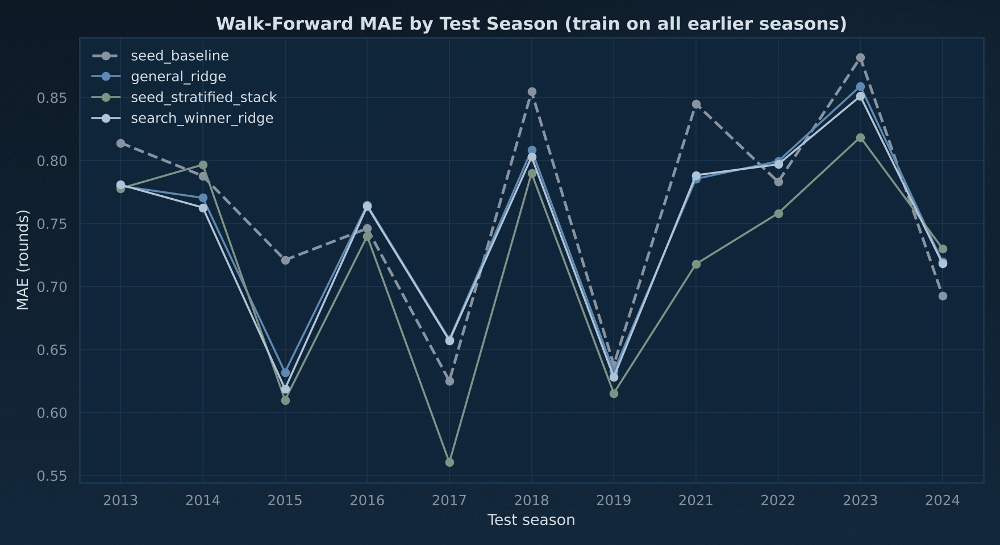

# Predictive Analysis Report (20261025)

## Headline
- Seed-only baseline (mean round of each seed in the training seasons): walk-forward 2013-2024 MAE `0.7626`, RMSE `1.0914`; 2025 holdout MAE `0.5874`, RMSE `0.7641`.
- Best model by pre-holdout walk-forward MSE: `seed_stratified_stack`. Walk-forward MAE `0.7195` (+5.7% vs baseline), RMSE `1.0585` (+3.0%); 2025 holdout MAE `0.5152` (+12.3%), RMSE `0.7101` (+7.1%).
- Walk-forward gap to the baseline, 95% season-bootstrap interval: MAE `-0.0431` [-0.0714, -0.0161], RMSE `-0.0329` [-0.0567, -0.0096]; lower MAE than the baseline in 9 of 11 test seasons.
- Seed-stratified stack beats the general model on both walk-forward MAE and RMSE. The MAE interval excludes zero; the RMSE interval does not. A modest gain, not a large one.
- Positive % = lower error than the baseline. Error is in rounds won (0-6). The 2025 holdout is one bracket of 64 teams, so it is a single noisy draw.

## Run Configuration
- input_csv: `data/processed/cbb_training_clean.csv`
- holdout_year: `2025`
- cv_folds_requested: `10` -> `GroupKFold(n_splits=10, groups=year, 16 seasons)`
- walk_forward_test_seasons: `2013, 2014, 2015, 2016, 2017, 2018, 2019, 2021, 2022, 2023, 2024`
- search_depth: `balanced`
- random_state: `42`
- pipeline_ridge_alpha_grid (configs/default.yaml): `[0.0, 0.01, 0.1, 0.3, 1.0, 3.0, 10.0]`
- bootstrap_draws: `10000`

## Validation Protocol
- **The season is the unit.** One season is one 64-team bracket of 63 games, so the rounds in a season always sum to 63 and a team's finish depends on its path. Every split keeps seasons whole; the old row-level StratifiedKFold and LOO put teams from the same bracket on both sides.
- **Grouped CV** (`GroupKFold(n_splits=10, groups=year, 16 seasons)`) on the 16 pre-holdout seasons picks ridge alphas, the feature set and the algorithm.
- **Walk-forward**: for each test season Y in 2013-2024, fit on every season before Y and predict Y. Ridge alphas are re-tuned inside each training window. The search winner's hyperparameters stay at the values grouped CV picked on all pre-holdout seasons, which include these test seasons, so its walk-forward score is mildly optimistic; the baseline, general ridge and stack select nothing outside the window.
- **Blind holdout**: 2025, fit on every season before it and scored once. Nothing is selected on it.
- **Seed-only baseline**: predicted round = mean round of that seed in the training seasons only.
- **Stack**: seed-model training rows get out-of-fold `predround` (general model refit without that season, inside the training window); test rows get `predround` from the general model fit on the whole window. `general_ridge` and `seed_stratified_stack` call the pipeline code in `src/pipelines/madness.py` directly.
- All predictions are clipped to [0, 6] before scoring. Spearman is the mean within-season rank correlation of predicted vs actual round.
- Every feature set passes `assert_no_target_leakage()` before it is fitted.

## Section 1: Data Profile
- dataset_shape: `5971 rows x 118 columns`
- year_range: `2008-2025`
- tournament_rows (seed+round non-null): `1088`
- non_tournament_rows: `4883`
- modeled_rows_excluding_2020: `1088`
- pre_holdout_rows (<2025): `1024` over `16` seasons
- holdout_rows (2025): `64`

### Distribution Summary
| feature | mean | std | min | 25% | 50% | 75% | max |
| --- | --- | --- | --- | --- | --- | --- | --- |
| AdjOE | 102.8510 | 7.4716 | 72.1000 | 97.8000 | 102.5000 | 107.7000 | 129.5000 |
| AdjDE | 102.8534 | 6.5015 | 81.8000 | 98.3000 | 103.0000 | 107.5000 | 125.3000 |
| Barthag | 0.4940 | 0.2565 | 0.0051 | 0.2781 | 0.4724 | 0.7155 | 0.9833 |
| seed | 8.7698 | 4.6715 | 1.0000 | 5.0000 | 9.0000 | 13.0000 | 16.0000 |
| round | 0.9844 | 1.3410 | 0.0000 | 0.0000 | 0.5000 | 1.2500 | 6.0000 |

### Missingness (candidate feature columns)

### Correlation Matrix

### Collinearity Note
- corr(Barthag, AdjOE) = `0.8594`, corr(Barthag, AdjDE) = `-0.8258`, corr(AdjOE, AdjDE) = `-0.4603`.
- Barthag is derived from offensive and defensive efficiency, so high multicollinearity is expected.

## Section 2: Feature Optimization (ridge, season-grouped CV)
`wf_*` columns are walk-forward scores for the top 3 sets by CV MSE (alpha re-tuned per window).

| feature_set | n_features | best_alpha | cv_mse | cv_mae | cv_rmse | cv_spearman | cv_mse_std | wf_mae | wf_rmse | wf_spearman |
| --- | --- | --- | --- | --- | --- | --- | --- | --- | --- | --- |
| baseline_raw_poly | 20 | 0.3000 | 1.0862 | 0.7358 | 1.0422 | 0.5942 | 0.1956 | 0.7461 | 1.0671 | 0.5892 |
| engineered_interactions | 23 | 0.3000 | 1.0898 | 0.7360 | 1.0439 | 0.5923 | 0.1937 | 0.7469 | 1.0684 | 0.5881 |
| baseline_plus_unused | 25 | 0.3000 | 1.0937 | 0.7375 | 1.0458 | 0.5890 | 0.1964 | 0.7495 | 1.0738 | 0.5827 |
| drop_barthag_keep_adjoe_adjde | 18 | 0.3000 | 1.1008 | 0.7386 | 1.0492 | 0.5957 | 0.1909 |  |  |  |
| raw_plus_rank | 41 | 0.3000 | 1.1039 | 0.7382 | 1.0507 | 0.5868 | 0.1975 |  |  |  |
| kitchen_sink_numeric_no_leakage | 95 | 30.0000 | 1.1585 | 0.7502 | 1.0763 | 0.5774 | 0.1786 |  |  |  |
| rank_only | 21 | 1.0000 | 1.1915 | 0.7715 | 1.0916 | 0.5816 | 0.1480 |  |  |  |

- selected_feature_set: `baseline_raw_poly`
- selected_feature_count: `20`
- selected_ridge_alpha: `0.3`

### VIF (Top 20)
| feature | vif |
| --- | --- |
| seed_2 | 1099.6722 |
| coach_tourn_games_5y | 767.5386 |
| seed_3 | 444.2399 |
| coach_tourn_wins_5y | 396.6781 |
| seed | 218.1813 |
| Barthag_2 | 213.4202 |
| Barthag | 111.1276 |
| coach_tourn_appearances_5y | 91.0799 |
| AdjDE | 37.4101 |
| AdjOE | 34.2934 |
| AdjDE_2 | 31.6164 |
| coach_avg_wins_per_appearance | 14.3600 |
| coach_tourn_win_pct_5y | 11.9705 |
| TALENT | 2.9325 |
| EFGD% | 2.4534 |
| TOR | 2.2838 |
| 3P% | 1.8182 |
| ORB | 1.8047 |
| coach_years_with_program | 1.4671 |
| AST% | 1.1976 |

### Scaled Ridge Coefficients (Top 25)
| feature | coef | abs_coef |
| --- | --- | --- |
| seed_2 | 2.984362 | 2.984362 |
| seed | -1.849467 | 1.849467 |
| seed_3 | -1.401536 | 1.401536 |
| coach_tourn_games_5y | 1.346693 | 1.346693 |
| AdjOE | 0.921734 | 0.921734 |
| coach_tourn_wins_5y | -0.912657 | 0.912657 |
| AdjDE | -0.763632 | 0.763632 |
| Barthag | -0.521227 | 0.521227 |
| coach_tourn_appearances_5y | -0.465233 | 0.465233 |
| Barthag_2 | -0.458529 | 0.458529 |
| AdjDE_2 | -0.149146 | 0.149146 |
| coach_tourn_win_pct_5y | -0.117103 | 0.117103 |
| TALENT | 0.104430 | 0.104430 |
| EFGD% | 0.096545 | 0.096545 |
| coach_avg_wins_per_appearance | 0.081359 | 0.081359 |
| AST% | -0.058924 | 0.058924 |
| ORB | 0.043538 | 0.043538 |
| TOR | -0.041964 | 0.041964 |
| 3P% | -0.026100 | 0.026100 |
| coach_years_with_program | 0.015509 | 0.015509 |

## Section 3: Algorithm Search (season-grouped CV)
`wf_*` columns are walk-forward scores for the top 3 configurations by CV MSE (hyperparameters fixed).

| model_id | algorithm | params | cv_mse | cv_mae | cv_rmse | cv_spearman | cv_mse_std | wf_mae | wf_rmse | wf_spearman |
| --- | --- | --- | --- | --- | --- | --- | --- | --- | --- | --- |
| 3 | ridge | alpha=0.3 | 1.0862 | 0.7358 | 1.0422 | 0.5942 | 0.1956 | 0.7426 | 1.0637 | 0.5874 |
| 2 | ridge | alpha=0.1 | 1.0863 | 0.7351 | 1.0423 | 0.5960 | 0.1984 | 0.7457 | 1.0660 | 0.5904 |
| 1 | ridge | alpha=0.01 | 1.0875 | 0.7351 | 1.0428 | 0.5967 | 0.2007 | 0.7499 | 1.0700 | 0.5890 |
| 4 | ridge | alpha=1.0 | 1.0893 | 0.7374 | 1.0437 | 0.5892 | 0.1927 |  |  |  |
| 5 | ridge | alpha=3.0 | 1.0945 | 0.7385 | 1.0462 | 0.5875 | 0.1901 |  |  |  |
| 6 | ridge | alpha=10.0 | 1.1005 | 0.7387 | 1.0490 | 0.5895 | 0.1842 |  |  |  |
| 15 | elasticnet | alpha=0.01, l1_ratio=0.25 | 1.1028 | 0.7388 | 1.0501 | 0.5920 | 0.1839 |  |  |  |
| 16 | elasticnet | alpha=0.01, l1_ratio=0.5 | 1.1068 | 0.7390 | 1.0520 | 0.5924 | 0.1822 |  |  |  |
| 17 | elasticnet | alpha=0.01, l1_ratio=0.75 | 1.1098 | 0.7391 | 1.0535 | 0.5941 | 0.1807 |  |  |  |
| 8 | lasso | alpha=0.01 | 1.1115 | 0.7396 | 1.0543 | 0.5950 | 0.1789 |  |  |  |
| 7 | ridge | alpha=30.0 | 1.1120 | 0.7393 | 1.0545 | 0.5968 | 0.1737 |  |  |  |
| 44 | rf | n_estimators=100, max_depth=5 | 1.1249 | 0.7474 | 1.0606 | 0.5907 | 0.2173 |  |  |  |
| 47 | rf | n_estimators=200, max_depth=5 | 1.1251 | 0.7471 | 1.0607 | 0.5898 | 0.2141 |  |  |  |
| 36 | gbr | n_estimators=100, max_depth=3, learning_rate=0.05 | 1.1602 | 0.7624 | 1.0771 | 0.5826 | 0.2096 |  |  |  |
| 18 | elasticnet | alpha=0.1, l1_ratio=0.25 | 1.1768 | 0.7569 | 1.0848 | 0.6055 | 0.1451 |  |  |  |
| 48 | rf | n_estimators=200, max_depth=10 | 1.1870 | 0.7719 | 1.0895 | 0.5680 | 0.1995 |  |  |  |
| 45 | rf | n_estimators=100, max_depth=10 | 1.1917 | 0.7720 | 1.0917 | 0.5694 | 0.2036 |  |  |  |
| 49 | rf | n_estimators=200, max_depth=None | 1.1989 | 0.7769 | 1.0950 | 0.5644 | 0.1862 |  |  |  |
| 46 | rf | n_estimators=100, max_depth=None | 1.2030 | 0.7780 | 1.0968 | 0.5630 | 0.1877 |  |  |  |
| 40 | gbr | n_estimators=200, max_depth=3, learning_rate=0.05 | 1.2099 | 0.7715 | 1.1000 | 0.5654 | 0.2092 |  |  |  |
| 19 | elasticnet | alpha=0.1, l1_ratio=0.5 | 1.2115 | 0.7678 | 1.1007 | 0.6011 | 0.1342 |  |  |  |
| 20 | elasticnet | alpha=0.1, l1_ratio=0.75 | 1.2196 | 0.7712 | 1.1044 | 0.5988 | 0.1278 |  |  |  |
| 9 | lasso | alpha=0.1 | 1.2293 | 0.7756 | 1.1087 | 0.5954 | 0.1209 |  |  |  |
| 21 | elasticnet | alpha=0.3, l1_ratio=0.25 | 1.2304 | 0.7790 | 1.1092 | 0.6007 | 0.1231 |  |  |  |
| 37 | gbr | n_estimators=100, max_depth=3, learning_rate=0.1 | 1.2311 | 0.7788 | 1.1096 | 0.5614 | 0.2068 |  |  |  |
| 38 | gbr | n_estimators=100, max_depth=5, learning_rate=0.05 | 1.2562 | 0.7862 | 1.1208 | 0.5574 | 0.2320 |  |  |  |
| 22 | elasticnet | alpha=0.3, l1_ratio=0.5 | 1.2593 | 0.7959 | 1.1222 | 0.6001 | 0.1026 |  |  |  |
| 41 | gbr | n_estimators=200, max_depth=3, learning_rate=0.1 | 1.2928 | 0.7983 | 1.1370 | 0.5377 | 0.1880 |  |  |  |
| 23 | elasticnet | alpha=0.3, l1_ratio=0.75 | 1.3000 | 0.8221 | 1.1402 | 0.5920 | 0.0815 |  |  |  |
| 42 | gbr | n_estimators=200, max_depth=5, learning_rate=0.05 | 1.3089 | 0.8015 | 1.1441 | 0.5345 | 0.2262 |  |  |  |

- winning_algorithm: `ridge`
- winning_params: `alpha=0.3`
- winning_cv_mse: `1.086174`
- winning_cv_mae: `0.735779`

## Section 4: Head-to-Head vs the Seed-Only Baseline (identical folds)
Every row is fit and scored on the same splits: `cv_*` = GroupKFold(n_splits=10, groups=year, 16 seasons) on seasons < 2025; `wf_*` = walk-forward 2013-2024; `holdout_2025_*` = fit on seasons < 2025, scored on 2025.

| model | cv_mae | cv_rmse | cv_spearman | wf_mae | wf_rmse | wf_spearman | holdout_2025_mae | holdout_2025_rmse | holdout_2025_spearman |
| --- | --- | --- | --- | --- | --- | --- | --- | --- | --- |
| seed_baseline | 0.7504 | 1.0690 | 0.5910 | 0.7626 | 1.0914 | 0.5805 | 0.5874 | 0.7641 | 0.7122 |
| general_ridge | 0.7361 | 1.0436 | 0.5952 | 0.7463 | 1.0672 | 0.5903 | 0.5484 | 0.7363 | 0.7571 |
| seed_stratified_stack | 0.7201 | 1.0398 | 0.6146 | 0.7195 | 1.0585 | 0.6128 | 0.5152 | 0.7101 | 0.7249 |
| ridge_baseline_raw_poly | 0.7362 | 1.0434 | 0.5950 | 0.7461 | 1.0671 | 0.5892 | 0.5529 | 0.7428 | 0.7613 |
| search_winner_ridge | 0.7358 | 1.0422 | 0.5942 | 0.7426 | 1.0637 | 0.5874 | 0.5529 | 0.7428 | 0.7613 |

### Gap to the Baseline
`d_*` = model minus baseline (negative = better). Intervals resample the walk-forward test seasons with replacement (10000 draws); with 11 seasons they are wide.

| model | wf_mae_pct_better | wf_rmse_pct_better | wf_d_mae | wf_d_mae_95ci | wf_d_rmse | wf_d_rmse_95ci | seasons_beating_baseline_mae | holdout_2025_mae_pct_better | holdout_2025_rmse_pct_better |
| --- | --- | --- | --- | --- | --- | --- | --- | --- | --- |
| general_ridge | 2.1426 | 2.2239 | -0.0163 | [-0.0386, +0.0050] | -0.0243 | [-0.0460, -0.0018] | 7/11 | 6.6350 | 3.6399 |
| seed_stratified_stack | 5.6539 | 3.0186 | -0.0431 | [-0.0714, -0.0161] | -0.0329 | [-0.0567, -0.0096] | 9/11 | 12.2897 | 7.0655 |
| ridge_baseline_raw_poly | 2.1691 | 2.2315 | -0.0165 | [-0.0387, +0.0048] | -0.0244 | [-0.0449, -0.0028] | 7/11 | 5.8737 | 2.7976 |
| search_winner_ridge | 2.6274 | 2.5466 | -0.0200 | [-0.0437, +0.0024] | -0.0278 | [-0.0516, -0.0029] | 7/11 | 5.8737 | 2.7976 |

- `search_winner_ridge`: hyperparameters chosen by grouped CV over seasons that include the walk-forward test seasons (see Validation Protocol).
- `ridge_baseline_raw_poly`: the CV-selected feature set; its alpha is re-tuned inside each window.

### Walk-Forward MAE by Test Season
| season | seed_baseline | general_ridge | seed_stratified_stack | ridge_baseline_raw_poly | search_winner_ridge |
| --- | --- | --- | --- | --- | --- |
| 2013 | 0.8141 | 0.7798 | 0.7779 | 0.7798 | 0.7807 |
| 2014 | 0.7878 | 0.7704 | 0.7967 | 0.7636 | 0.7627 |
| 2015 | 0.7210 | 0.6319 | 0.6099 | 0.6319 | 0.6187 |
| 2016 | 0.7461 | 0.7647 | 0.7399 | 0.7647 | 0.7637 |
| 2017 | 0.6250 | 0.6581 | 0.5604 | 0.6581 | 0.6571 |
| 2018 | 0.8547 | 0.8084 | 0.7900 | 0.8084 | 0.8028 |
| 2019 | 0.6378 | 0.6326 | 0.6153 | 0.6326 | 0.6281 |
| 2021 | 0.8451 | 0.7855 | 0.7178 | 0.7855 | 0.7883 |
| 2022 | 0.7831 | 0.7994 | 0.7581 | 0.7994 | 0.7970 |
| 2023 | 0.8817 | 0.8590 | 0.8185 | 0.8648 | 0.8511 |
| 2024 | 0.6927 | 0.7194 | 0.7301 | 0.7182 | 0.7182 |

### Walk-Forward RMSE by Test Season
| season | seed_baseline | general_ridge | seed_stratified_stack | ridge_baseline_raw_poly | search_winner_ridge |
| --- | --- | --- | --- | --- | --- |
| 2013 | 1.1621 | 1.0966 | 1.1283 | 1.0966 | 1.0929 |
| 2014 | 1.2018 | 1.1888 | 1.2152 | 1.1776 | 1.1728 |
| 2015 | 0.9732 | 0.9067 | 0.9329 | 0.9067 | 0.8944 |
| 2016 | 1.0473 | 1.0687 | 1.0475 | 1.0687 | 1.0772 |
| 2017 | 0.9141 | 0.9310 | 0.8624 | 0.9310 | 0.9405 |
| 2018 | 1.1732 | 1.1675 | 1.1305 | 1.1675 | 1.1592 |
| 2019 | 0.9131 | 0.8657 | 0.8439 | 0.8657 | 0.8672 |
| 2021 | 1.1165 | 1.0494 | 1.0049 | 1.0494 | 1.0530 |
| 2022 | 1.1372 | 1.1364 | 1.1167 | 1.1364 | 1.1351 |
| 2023 | 1.3181 | 1.2493 | 1.2609 | 1.2600 | 1.2349 |
| 2024 | 0.9705 | 1.0074 | 1.0134 | 1.0062 | 1.0062 |

## Section 5: Do the Seed-Stratified Models Help?
The stack is the general model plus 14 ridge models, one per overlapping 3-seed band, each with a hand-picked feature list from `madness.R` and the general model's `predround` as an input.
The 14 lists were hand-picked, not selected out of sample. 13 of them match `madness.R` as committed on 2025-01-16 (commit 21a1e96) once the `WAB` terms are removed, and band 9 has since dropped `W`, so they were fixed before the 2025 tournament but after seeing earlier seasons, including the walk-forward ones.

Rule for `model.use_seed_models`: keep the stack only if it has lower walk-forward MAE and MSE than the general model and at least one season-bootstrap interval for the gap excludes zero.

- The stack beats the general model on both walk-forward MAE and RMSE. The MAE interval excludes zero; the RMSE interval does not. A modest gain, not a large one.
- Stack minus general, walk-forward: MAE `-0.0268` [-0.0474, -0.0080], RMSE `-0.0087` [-0.0274, +0.0087]; stack has the lower MAE in 9 of 11 seasons.
- Stack vs baseline, walk-forward: MAE +5.7%, RMSE +3.0%. General vs baseline: MAE +2.1%, RMSE +2.2%.

### Walk-Forward MAE by Seed Group
| seeds | n_rows | seed_baseline_mae | general_ridge_mae | seed_stratified_stack_mae |
| --- | --- | --- | --- | --- |
| 1-4 | 176 | 1.2221 | 1.1504 | 1.1530 |
| 5-8 | 176 | 0.8242 | 0.8414 | 0.8279 |
| 9-12 | 176 | 0.7424 | 0.6939 | 0.6653 |
| 13-16 | 176 | 0.2619 | 0.2995 | 0.2318 |

### Why predround Must Be Out-of-Fold
Seed-model leave-one-season-out MSE on seasons < 2025, with `predround` from the in-sample general fit (the old pipeline) vs out-of-fold by season (now). `optimism` = how much the in-sample version flatters the score.

| model_id | seeds | n_train | season_cv_mse_in_sample_predround | season_cv_mse_oof_predround | optimism |
| --- | --- | --- | --- | --- | --- |
| 1 | 1,2 | 128 | 2.3876 | 2.5041 | 0.1165 |
| 2 | 1,2,3 | 192 | 2.1405 | 2.2107 | 0.0701 |
| 3 | 2,3,4 | 192 | 1.7014 | 1.7036 | 0.0023 |
| 4 | 3,4,5 | 192 | 1.5981 | 1.6039 | 0.0058 |
| 5 | 4,5,6 | 192 | 1.3526 | 1.3790 | 0.0264 |
| 6 | 5,6,7 | 192 | 1.2811 | 1.2968 | 0.0157 |
| 7 | 6,7,8 | 192 | 1.0964 | 1.1071 | 0.0107 |
| 8 | 7,8,9 | 192 | 1.0716 | 1.0919 | 0.0203 |
| 9 | 8,9,10 | 192 | 0.8906 | 0.9221 | 0.0314 |
| 10 | 9,10,11 | 192 | 0.9664 | 0.9818 | 0.0154 |
| 11 | 10,11,12 | 192 | 0.8913 | 0.9148 | 0.0235 |
| 12 | 11,12,13 | 192 | 0.6921 | 0.6971 | 0.0051 |
| 13 | 12,13,14 | 192 | 0.2923 | 0.2866 | -0.0057 |
| 14 | 13,14,15 | 192 | 0.2379 | 0.2358 | -0.0022 |

- mean optimism across 14 seed models: `+0.0240` MSE; in-sample version scored better on `12` of `14`.

## Section 6: Holdout 2025 Detail + Final Retrain
- holdout_rows_scored: `64`
- recommended model on the holdout: `seed_stratified_stack`
- final_retrain_rows (search winner, all seasons): `1088`
- model_artifact (search winner, not committed): `models/analysis_best_model_20261025.joblib`

### Holdout Prediction Table (`seed_stratified_stack`, top 20 by predicted round)
| Team | year | seed | actual_round | pred_round | seed_baseline |
| --- | --- | --- | --- | --- | --- |
| Houston | 2025 | 1.0000 | 5.0000 | 4.6723 | 3.2188 |
| Duke | 2025 | 1.0000 | 4.0000 | 4.5054 | 3.2188 |
| Auburn | 2025 | 1.0000 | 4.0000 | 4.5011 | 3.2188 |
| Florida | 2025 | 1.0000 | 6.0000 | 3.7432 | 3.2188 |
| Iowa St. | 2025 | 3.0000 | 1.0000 | 2.6955 | 1.9062 |
| Tennessee | 2025 | 2.0000 | 3.0000 | 2.4546 | 2.1719 |
| Alabama | 2025 | 2.0000 | 3.0000 | 2.4311 | 2.1719 |
| Texas Tech | 2025 | 3.0000 | 3.0000 | 2.2909 | 1.9062 |
| Michigan St. | 2025 | 2.0000 | 3.0000 | 2.2151 | 2.1719 |
| St. John's | 2025 | 2.0000 | 1.0000 | 2.1137 | 2.1719 |
| Arizona | 2025 | 4.0000 | 2.0000 | 2.1113 | 1.6094 |
| Purdue | 2025 | 4.0000 | 2.0000 | 2.1012 | 1.6094 |
| Maryland | 2025 | 4.0000 | 2.0000 | 2.0837 | 1.6094 |
| Wisconsin | 2025 | 3.0000 | 1.0000 | 2.0680 | 1.9062 |
| Kentucky | 2025 | 3.0000 | 2.0000 | 2.0180 | 1.9062 |
| Texas A&M | 2025 | 4.0000 | 1.0000 | 1.6277 | 1.6094 |
| North Carolina | 2025 | 11.0000 | 0.0000 | 1.3452 | 0.9062 |
| Mississippi | 2025 | 6.0000 | 2.0000 | 1.2471 | 0.7344 |
| Saint Mary's | 2025 | 7.0000 | 1.0000 | 1.2265 | 0.9375 |
| Xavier | 2025 | 11.0000 | 0.0000 | 1.2068 | 0.9062 |

### Search Winner Feature Importance (ridge)

| feature | importance |
| --- | --- |
| seed_2 | 2.984362 |
| seed | 1.849467 |
| seed_3 | 1.401536 |
| coach_tourn_games_5y | 1.346693 |
| AdjOE | 0.921734 |
| coach_tourn_wins_5y | 0.912657 |
| AdjDE | 0.763632 |
| Barthag | 0.521227 |
| coach_tourn_appearances_5y | 0.465233 |
| Barthag_2 | 0.458529 |
| AdjDE_2 | 0.149146 |
| coach_tourn_win_pct_5y | 0.117103 |
| TALENT | 0.104430 |
| EFGD% | 0.096545 |
| coach_avg_wins_per_appearance | 0.081359 |
| AST% | 0.058924 |
| ORB | 0.043538 |
| TOR | 0.041964 |
| 3P% | 0.026100 |
| coach_years_with_program | 0.015509 |

## Recommendation
Use `seed_stratified_stack`: lowest walk-forward MSE on seasons before 2025, ahead of the seed-only baseline by +5.7% MAE and +3.0% RMSE. Read the gap against the bootstrap interval above before calling it real.

Seed-stratified models: the walk-forward evidence says keep them. `model.use_seed_models` in `configs/default.yaml` is currently `true`.
