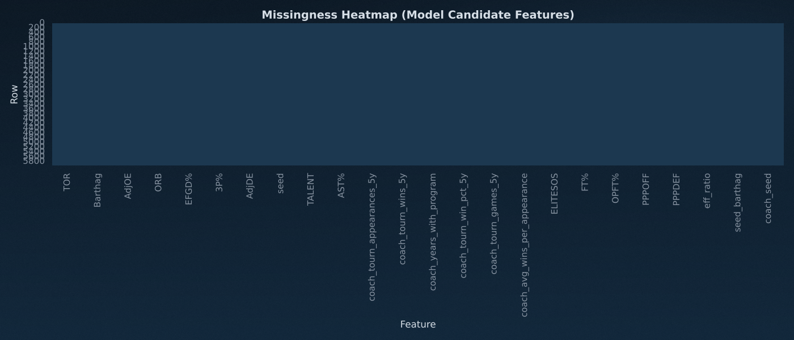
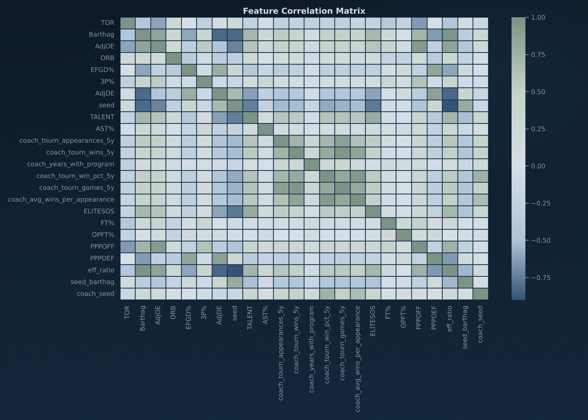
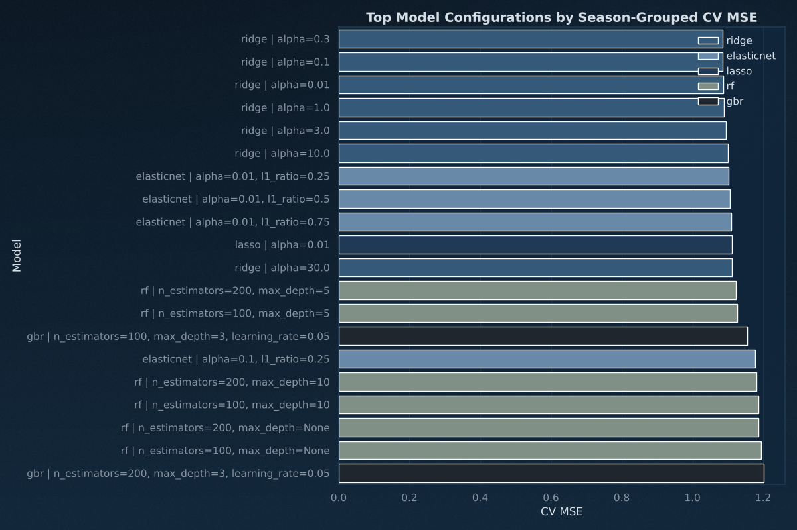
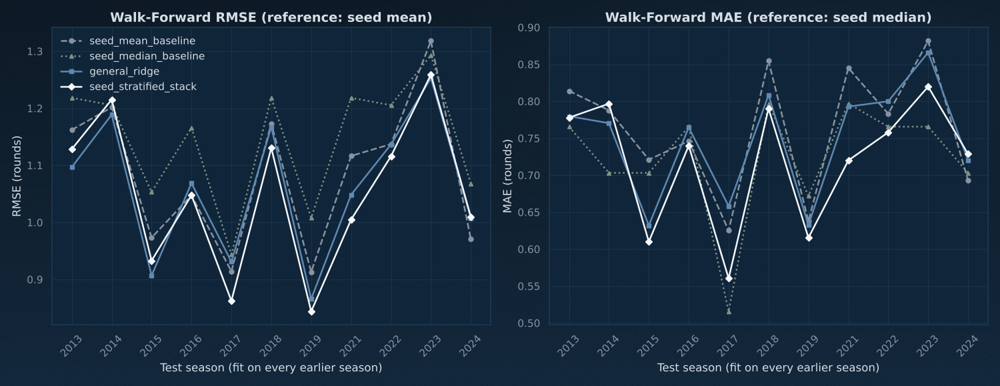
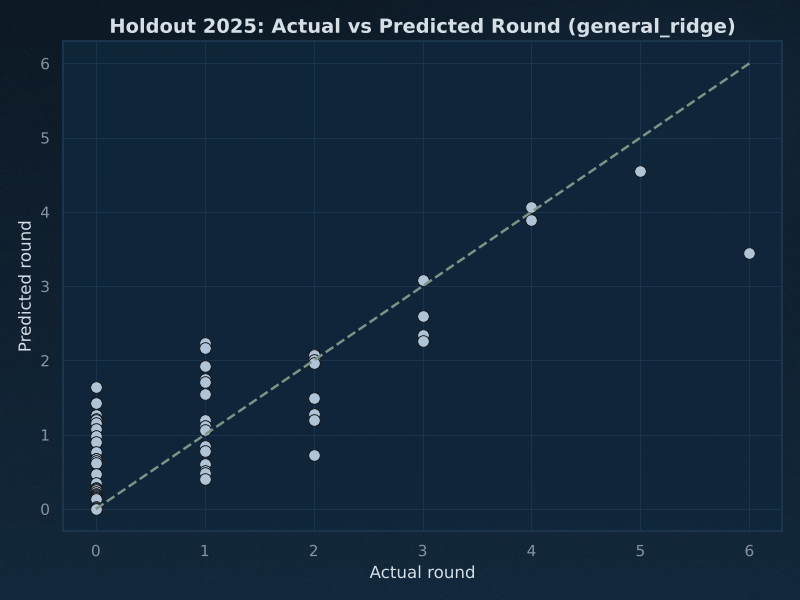
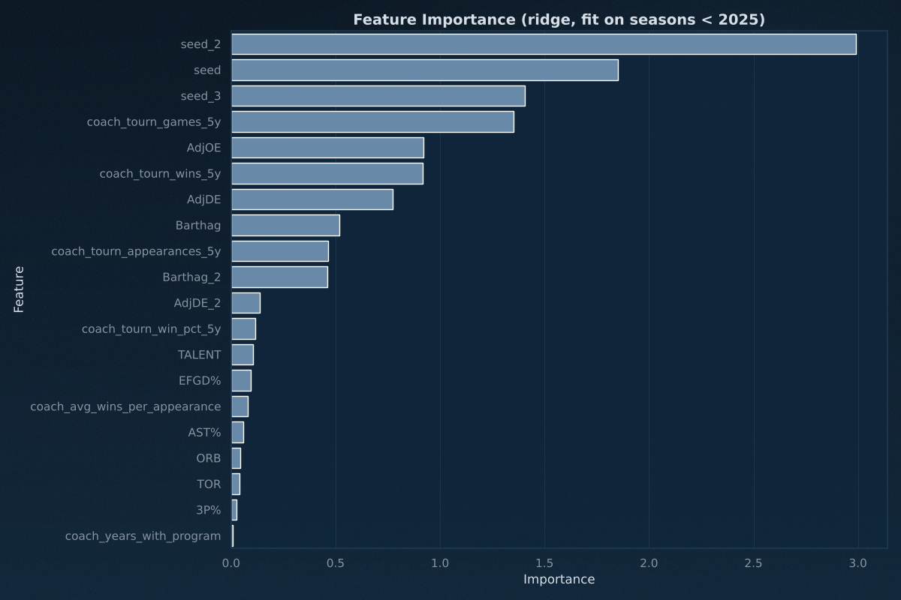

# Predictive Analysis Report (20261025)

## Headline
- **Metrics.** Every model is fit by least squares, so the headline is walk-forward RMSE against the per-seed **mean**, the best seed-only predictor under squared error. MAE is minimised by the median, so MAE is scored against the per-seed **median**. Scored against the seed mean instead, a least-squares model's MAE gain mostly measures the mean's mismatch with the metric (Section 4 shows both).
- **Seed-only baselines** (fit on training seasons only), walk-forward 2013-2024: seed mean RMSE `1.0914` (MAE `0.7626`); seed median MAE `0.7230` (RMSE `1.1500`). 2025 holdout: seed mean RMSE `0.7641`, seed median MAE `0.5469`.
- **Bottom line.** On walk-forward RMSE the 5 candidates are +2.2% to +3.1% against the seed mean. The 95% interval on the per-season MSE gap excludes zero for 2 of them (`general_ridge_no_coach`, `seed_stratified_stack`); after Holm adjustment, 0 keep p < 0.05. On MAE, the candidates that beat the per-seed median with an interval below zero: none.
- **`general_ridge`** (pipeline default when the stack is off): walk-forward RMSE `1.0675` (+2.2% vs seed mean; per-season MSE gap `-0.0518` [-0.1098, +0.0062], which includes zero; Holm p `0.337`), MAE `0.7477` (-3.4% vs seed median; gap [-0.0160, +0.0653], which includes zero). 2025 holdout RMSE `0.7365` (+3.6%), MAE `0.5493` (-0.4%).
- **`seed_stratified_stack`** (general model + 14 seed-band models): walk-forward RMSE `1.0579` (+3.1% vs seed mean; per-season MSE gap `-0.0721` [-0.1308, -0.0133], which excludes zero; Holm p `0.127`), MAE `0.7197` (+0.5% vs seed median; gap [-0.0419, +0.0352], which includes zero). 2025 holdout RMSE `0.7105` (+7.0%), MAE `0.5159` (+5.7%).
- **Do the seed models help?** Stack minus general, walk-forward per-season MSE gap `-0.0203` [-0.0644, +0.0238], lower in 6 of 11 seasons. The stack has nominally lower walk-forward MSE than the general model, but the 95% interval on the per-season MSE gap includes zero: the 14 hand-picked per-band feature lists are not shown to help. Pipeline default: `general_ridge` (`model.use_seed_models: false`).
- **Lowest walk-forward MSE: `seed_stratified_stack`** (RMSE `1.0579`). It is the best of 5 candidates on the same 11 seasons it is scored on, so that walk-forward number is optimistic (winner's curse). Its 2025 holdout score is the clean one: RMSE `0.7105` (+7.0% vs seed mean).
- **Multiplicity.** After Holm adjustment over the 7 primary (MSE) comparisons, 0 of 7 gaps have adjusted p < 0.05. Intervals in this report are unadjusted 95% Student-t intervals over seasons.
- **Holdout provenance.** 2025 is excluded from every fit and every selection step in this script and scored once. It is not blind to feature design: the 6 coach features in `GEN_FEATURES` were added after the 2025 tournament (absent at commit 0f6eb0c, 2026-01-31; the decision log in `docs/modeling_plan.md` dates them 2026-03), and every seed model consumes the general model's `predround`. `general_ridge_no_coach` drops them, which leaves the `predround` model of `madness.R` at commit 21a1e96 (2025-01-16) minus `WAB`, a column the current data does not have: walk-forward RMSE `1.0592` (+3.0% vs seed mean; per-season MSE gap `-0.0693` [-0.1212, -0.0173], which excludes zero; Holm p `0.098`), MAE `0.7454` (-3.1% vs seed median; gap [-0.0227, +0.0675], which includes zero). 2025 holdout RMSE `0.7389` (+3.3%), MAE `0.5480` (-0.2%). The 14 seed-band lists come from the same commit, less `WAB` (Section 5).
- **Do the coach features help?** `general_ridge` minus `general_ridge_no_coach`, walk-forward per-season MSE gap `+0.0175` [-0.0041, +0.0391] (Holm p `0.337`), lower with them in 2 of 11 seasons; 2025 holdout RMSE `0.7365` with them vs `0.7389` without. By the same MSE rule used for the seed models, they are not shown to help.
- Positive % = lower error than the reference baseline. Error is in rounds won (0-6). The 2025 holdout is one bracket of 64 teams, so it is a single noisy draw.

## Run Configuration
- input_csv: `data/processed/cbb_training_clean.csv`
- holdout_year: `2025`
- cv_folds_requested: `10` -> `GroupKFold(n_splits=10, groups=year, 16 seasons)`
- walk_forward_test_seasons: `2013, 2014, 2015, 2016, 2017, 2018, 2019, 2021, 2022, 2023, 2024`
- search_depth: `balanced`
- random_state: `42`
- pipeline_ridge_alpha_grid (configs/default.yaml): `[0.0, 0.01, 0.1, 0.3, 1.0, 3.0, 10.0]`
- pipeline_use_seed_models (configs/default.yaml): `false`
- interval: `95% Student-t over walk-forward seasons, Holm within each family`

## Validation Protocol
- **The season is the unit.** One season is one 64-team bracket of 63 games, so the rounds in a season always sum to 63 and a team's finish depends on its path. Every split keeps seasons whole; the old row-level StratifiedKFold and LOO put teams from the same bracket on both sides.
- **Grouped CV** (`GroupKFold(n_splits=10, groups=year, 16 seasons)`) on the 16 pre-holdout seasons picks ridge alphas, the feature set and the algorithm.
- **Walk-forward**: for each test season Y in 2013-2024, fit on every season before Y and predict Y. Ridge alphas are re-tuned inside each training window. The baselines, `general_ridge` and the stack select nothing outside the window. Two candidates do: the feature set behind `ridge_baseline_raw_poly` and `search_winner_ridge`, and the search winner's hyperparameters, were chosen by grouped CV over all pre-holdout seasons, which include these test seasons, so their walk-forward scores are mildly optimistic.
- **Holdout**: 2025, fit on every season before it and scored once. Nothing in this script is selected on it; see Holdout provenance above for what was decided outside the script after that tournament.
- **Seed-only baselines**: predicted round = mean (RMSE reference) or median (MAE reference) round of that seed in the training seasons only.
- **Stack**: seed-model training rows get out-of-fold `predround` (general model refit without that season, inside the training window); test rows get `predround` from the general model fit on the whole window. `general_ridge` and `seed_stratified_stack` call the pipeline code in `src/pipelines/madness.py` directly.
- **Uncertainty**: every gap is a mean of per-season differences over the 11 walk-forward seasons, with a 95% Student-t interval (10 df), a t-test p-value, a Holm-adjusted p within its family, and a two-sided sign test on the season count. Primary family: MSE vs the seed mean for each model, stack vs general, and the general model with vs without the coach features. Secondary family: the same comparisons on MAE, with the seed median as the baseline.
- All predictions are clipped to [0, 6] before scoring. Spearman is the mean within-season rank correlation of predicted vs actual round.
- Every feature set passes `assert_no_target_leakage()` before it is fitted.

## Section 1: Data Profile
- dataset_shape: `5971 rows x 118 columns`
- year_range: `2008-2025`
- tournament_rows (seed+round non-null): `1088`
- non_tournament_rows: `4883`
- modeled_rows_excluding_2020: `1088`
- pre_holdout_rows (<2025): `1024` over `16` seasons
- holdout_rows (2025): `64`

### Distribution Summary
| feature | mean | std | min | 25% | 50% | 75% | max |
| --- | --- | --- | --- | --- | --- | --- | --- |
| AdjOE | 102.8510 | 7.4716 | 72.1000 | 97.8000 | 102.5000 | 107.7000 | 129.5000 |
| AdjDE | 102.8534 | 6.5015 | 81.8000 | 98.3000 | 103.0000 | 107.5000 | 125.3000 |
| Barthag | 0.4940 | 0.2565 | 0.0051 | 0.2781 | 0.4724 | 0.7155 | 0.9833 |
| seed | 8.7698 | 4.6715 | 1.0000 | 5.0000 | 9.0000 | 13.0000 | 16.0000 |
| round | 0.9844 | 1.3410 | 0.0000 | 0.0000 | 0.5000 | 1.2500 | 6.0000 |

### Missingness (candidate feature columns)

### Correlation Matrix

### Collinearity Note
- corr(Barthag, AdjOE) = `0.8594`, corr(Barthag, AdjDE) = `-0.8258`, corr(AdjOE, AdjDE) = `-0.4603`.
- Barthag is derived from offensive and defensive efficiency, so high multicollinearity is expected.

## Section 2: Feature Optimization (ridge, season-grouped CV)
`wf_*` columns are walk-forward scores for the top 3 sets by CV MSE (alpha re-tuned per window).
The kitchen-sink set is every numeric column except outcomes, `PAKE`/`PASE`, `year` and table-parse artifacts (`blank`, `_extra_*`).

| feature_set | n_features | best_alpha | cv_mse | cv_mae | cv_rmse | cv_spearman | cv_mse_std | wf_mae | wf_rmse | wf_spearman |
| --- | --- | --- | --- | --- | --- | --- | --- | --- | --- | --- |
| baseline_raw_poly | 20 | 0.3000 | 1.0858 | 0.7360 | 1.0420 | 0.5940 | 0.1962 | 0.7477 | 1.0676 | 0.5914 |
| engineered_interactions | 23 | 0.3000 | 1.0894 | 0.7361 | 1.0437 | 0.5940 | 0.1941 | 0.7484 | 1.0688 | 0.5896 |
| baseline_plus_unused | 25 | 0.3000 | 1.0944 | 0.7386 | 1.0461 | 0.5886 | 0.1976 | 0.7509 | 1.0742 | 0.5855 |
| drop_barthag_keep_adjoe_adjde | 18 | 0.3000 | 1.1006 | 0.7390 | 1.0491 | 0.5944 | 0.1912 |  |  |  |
| raw_plus_rank | 41 | 0.3000 | 1.1072 | 0.7406 | 1.0522 | 0.5867 | 0.1992 |  |  |  |
| kitchen_sink_numeric_no_leakage | 89 | 30.0000 | 1.1562 | 0.7484 | 1.0752 | 0.5787 | 0.1812 |  |  |  |
| rank_only | 21 | 1.0000 | 1.1927 | 0.7701 | 1.0921 | 0.5837 | 0.1482 |  |  |  |

- selected_feature_set: `baseline_raw_poly`
- selected_feature_count: `20`
- selected_ridge_alpha: `0.3`

### VIF (Top 20)
| feature | vif |
| --- | --- |
| seed_2 | 1098.7676 |
| coach_tourn_games_5y | 768.1892 |
| seed_3 | 443.9136 |
| coach_tourn_wins_5y | 397.5379 |
| seed | 218.1126 |
| Barthag_2 | 213.6191 |
| Barthag | 111.1459 |
| coach_tourn_appearances_5y | 91.4620 |
| AdjDE | 37.4130 |
| AdjOE | 34.3516 |
| AdjDE_2 | 31.6207 |
| coach_avg_wins_per_appearance | 14.3114 |
| coach_tourn_win_pct_5y | 11.9696 |
| TALENT | 2.9717 |
| EFGD% | 2.4345 |
| TOR | 2.2900 |
| ORB | 1.8381 |
| 3P% | 1.8155 |
| coach_years_with_program | 1.5597 |
| AST% | 1.1974 |

### Scaled Ridge Coefficients (Top 25)
| feature | coef | abs_coef |
| --- | --- | --- |
| seed_2 | 2.991807 | 2.991807 |
| seed | -1.850858 | 1.850858 |
| seed_3 | -1.406196 | 1.406196 |
| coach_tourn_games_5y | 1.353681 | 1.353681 |
| AdjOE | 0.921520 | 0.921520 |
| coach_tourn_wins_5y | -0.916323 | 0.916323 |
| AdjDE | -0.772819 | 0.772819 |
| Barthag | -0.519295 | 0.519295 |
| coach_tourn_appearances_5y | -0.462803 | 0.462803 |
| Barthag_2 | -0.460833 | 0.460833 |
| AdjDE_2 | -0.137648 | 0.137648 |
| coach_tourn_win_pct_5y | -0.116070 | 0.116070 |
| TALENT | 0.105042 | 0.105042 |
| EFGD% | 0.094277 | 0.094277 |
| coach_avg_wins_per_appearance | 0.078717 | 0.078717 |
| AST% | -0.058713 | 0.058713 |
| ORB | 0.044958 | 0.044958 |
| TOR | -0.042014 | 0.042014 |
| 3P% | -0.024443 | 0.024443 |
| coach_years_with_program | 0.007474 | 0.007474 |

## Section 3: Algorithm Search (season-grouped CV)
`wf_*` columns are walk-forward scores for the top 3 configurations by CV MSE (hyperparameters fixed).

| model_id | algorithm | params | cv_mse | cv_mae | cv_rmse | cv_spearman | cv_mse_std | wf_mae | wf_rmse | wf_spearman |
| --- | --- | --- | --- | --- | --- | --- | --- | --- | --- | --- |
| 3 | ridge | alpha=0.3 | 1.0858 | 0.7360 | 1.0420 | 0.5940 | 0.1962 | 0.7444 | 1.0640 | 0.5894 |
| 2 | ridge | alpha=0.1 | 1.0859 | 0.7353 | 1.0421 | 0.5973 | 0.1989 | 0.7471 | 1.0663 | 0.5911 |
| 1 | ridge | alpha=0.01 | 1.0870 | 0.7352 | 1.0426 | 0.5974 | 0.2012 | 0.7512 | 1.0703 | 0.5902 |
| 4 | ridge | alpha=1.0 | 1.0891 | 0.7379 | 1.0436 | 0.5913 | 0.1935 |  |  |  |
| 5 | ridge | alpha=3.0 | 1.0945 | 0.7391 | 1.0462 | 0.5885 | 0.1909 |  |  |  |
| 6 | ridge | alpha=10.0 | 1.1006 | 0.7393 | 1.0491 | 0.5909 | 0.1848 |  |  |  |
| 15 | elasticnet | alpha=0.01, l1_ratio=0.25 | 1.1028 | 0.7393 | 1.0501 | 0.5922 | 0.1845 |  |  |  |
| 16 | elasticnet | alpha=0.01, l1_ratio=0.5 | 1.1068 | 0.7394 | 1.0520 | 0.5921 | 0.1826 |  |  |  |
| 17 | elasticnet | alpha=0.01, l1_ratio=0.75 | 1.1101 | 0.7395 | 1.0536 | 0.5933 | 0.1810 |  |  |  |
| 8 | lasso | alpha=0.01 | 1.1119 | 0.7400 | 1.0545 | 0.5943 | 0.1791 |  |  |  |
| 7 | ridge | alpha=30.0 | 1.1121 | 0.7399 | 1.0546 | 0.5970 | 0.1740 |  |  |  |
| 47 | rf | n_estimators=200, max_depth=5 | 1.1238 | 0.7459 | 1.0601 | 0.5930 | 0.2121 |  |  |  |
| 44 | rf | n_estimators=100, max_depth=5 | 1.1259 | 0.7470 | 1.0611 | 0.5910 | 0.2153 |  |  |  |
| 36 | gbr | n_estimators=100, max_depth=3, learning_rate=0.05 | 1.1551 | 0.7600 | 1.0748 | 0.5830 | 0.2164 |  |  |  |
| 18 | elasticnet | alpha=0.1, l1_ratio=0.25 | 1.1772 | 0.7572 | 1.0850 | 0.6058 | 0.1453 |  |  |  |
| 48 | rf | n_estimators=200, max_depth=10 | 1.1809 | 0.7682 | 1.0867 | 0.5697 | 0.2075 |  |  |  |
| 45 | rf | n_estimators=100, max_depth=10 | 1.1870 | 0.7703 | 1.0895 | 0.5683 | 0.2175 |  |  |  |
| 49 | rf | n_estimators=200, max_depth=None | 1.1871 | 0.7747 | 1.0896 | 0.5650 | 0.1923 |  |  |  |
| 46 | rf | n_estimators=100, max_depth=None | 1.1933 | 0.7772 | 1.0924 | 0.5644 | 0.2035 |  |  |  |
| 40 | gbr | n_estimators=200, max_depth=3, learning_rate=0.05 | 1.2017 | 0.7657 | 1.0962 | 0.5659 | 0.2210 |  |  |  |
| 37 | gbr | n_estimators=100, max_depth=3, learning_rate=0.1 | 1.2111 | 0.7699 | 1.1005 | 0.5607 | 0.2246 |  |  |  |
| 19 | elasticnet | alpha=0.1, l1_ratio=0.5 | 1.2115 | 0.7678 | 1.1007 | 0.6011 | 0.1342 |  |  |  |
| 20 | elasticnet | alpha=0.1, l1_ratio=0.75 | 1.2196 | 0.7712 | 1.1044 | 0.5988 | 0.1278 |  |  |  |
| 9 | lasso | alpha=0.1 | 1.2293 | 0.7756 | 1.1087 | 0.5954 | 0.1209 |  |  |  |
| 21 | elasticnet | alpha=0.3, l1_ratio=0.25 | 1.2304 | 0.7790 | 1.1092 | 0.6007 | 0.1231 |  |  |  |
| 22 | elasticnet | alpha=0.3, l1_ratio=0.5 | 1.2593 | 0.7959 | 1.1222 | 0.6001 | 0.1026 |  |  |  |
| 38 | gbr | n_estimators=100, max_depth=5, learning_rate=0.05 | 1.2691 | 0.7852 | 1.1266 | 0.5569 | 0.2313 |  |  |  |
| 41 | gbr | n_estimators=200, max_depth=3, learning_rate=0.1 | 1.2699 | 0.7823 | 1.1269 | 0.5428 | 0.2259 |  |  |  |
| 23 | elasticnet | alpha=0.3, l1_ratio=0.75 | 1.3000 | 0.8221 | 1.1402 | 0.5920 | 0.0815 |  |  |  |
| 42 | gbr | n_estimators=200, max_depth=5, learning_rate=0.05 | 1.3156 | 0.7987 | 1.1470 | 0.5356 | 0.2294 |  |  |  |

- winning_algorithm: `ridge`
- winning_params: `alpha=0.3`
- winning_cv_mse: `1.085847`
- winning_cv_mae: `0.736048`

## Section 4: Head-to-Head vs the Seed-Only Baselines (identical folds)
Every row is fit and scored on the same splits: `cv_*` = GroupKFold(n_splits=10, groups=year, 16 seasons) on seasons < 2025; `wf_*` = walk-forward 2013-2024; `holdout_2025_*` = fit on seasons < 2025, scored on 2025.

| model | cv_mae | cv_rmse | cv_spearman | wf_mae | wf_rmse | wf_spearman | holdout_2025_mae | holdout_2025_rmse | holdout_2025_spearman |
| --- | --- | --- | --- | --- | --- | --- | --- | --- | --- |
| seed_mean_baseline | 0.7504 | 1.0690 | 0.5910 | 0.7626 | 1.0914 | 0.5805 | 0.5874 | 0.7641 | 0.7122 |
| seed_median_baseline | 0.7207 | 1.1246 | 0.5294 | 0.7230 | 1.1500 | 0.5251 | 0.5469 | 0.8385 | 0.6901 |
| general_ridge | 0.7363 | 1.0434 | 0.5958 | 0.7477 | 1.0675 | 0.5910 | 0.5493 | 0.7365 | 0.7571 |
| general_ridge_no_coach | 0.7334 | 1.0391 | 0.5969 | 0.7454 | 1.0592 | 0.5884 | 0.5480 | 0.7389 | 0.7619 |
| seed_stratified_stack | 0.7200 | 1.0397 | 0.6152 | 0.7197 | 1.0579 | 0.6124 | 0.5159 | 0.7105 | 0.7249 |
| ridge_baseline_raw_poly | 0.7367 | 1.0436 | 0.5949 | 0.7477 | 1.0676 | 0.5914 | 0.5537 | 0.7431 | 0.7613 |
| search_winner_ridge | 0.7360 | 1.0420 | 0.5940 | 0.7444 | 1.0640 | 0.5894 | 0.5537 | 0.7431 | 0.7613 |

### RMSE vs the Seed-Mean Baseline (primary)
`wf_d_mse` = mean over walk-forward seasons of (model MSE - seed-mean MSE); negative = better. `p_holm` is adjusted over 7 comparisons: these rows, stack vs general (Section 5) and `general_ridge` vs `general_ridge_no_coach` (Headline). `p_sign` is a two-sided sign test on `seasons_better`.

| model | wf_rmse | wf_rmse_pct_better | wf_d_mse | wf_d_mse_95ci | p_t | p_holm | seasons_better | p_sign | holdout_2025_rmse_pct_better |
| --- | --- | --- | --- | --- | --- | --- | --- | --- | --- |
| general_ridge | 1.0675 | 2.1973 | -0.0518 | [-0.1098, +0.0062] | 0.0748 | 0.3373 | 8/11 | 0.2266 | 3.6116 |
| general_ridge_no_coach | 1.0592 | 2.9502 | -0.0693 | [-0.1212, -0.0173] | 0.0140 | 0.0982 | 9/11 | 0.0654 | 3.3060 |
| seed_stratified_stack | 1.0579 | 3.0723 | -0.0721 | [-0.1308, -0.0133] | 0.0211 | 0.1266 | 8/11 | 0.2266 | 7.0242 |
| ridge_baseline_raw_poly | 1.0676 | 2.1813 | -0.0514 | [-0.1073, +0.0045] | 0.0675 | 0.3373 | 7/11 | 0.5488 | 2.7575 |
| search_winner_ridge | 1.0640 | 2.5171 | -0.0592 | [-0.1236, +0.0052] | 0.0678 | 0.3373 | 8/11 | 0.2266 | 2.7575 |

### MAE vs the Seed-Median Baseline (secondary)
`wf_d_mae` = mean over walk-forward seasons of (model MAE - seed-median MAE). The last column scores the same MAE against the seed mean instead, to show how much a mean baseline flatters a least-squares model on MAE.

| model | wf_mae | wf_mae_pct_better | wf_d_mae | wf_d_mae_95ci | p_t | p_holm | seasons_better | p_sign | holdout_2025_mae_pct_better | wf_mae_pct_vs_seed_mean |
| --- | --- | --- | --- | --- | --- | --- | --- | --- | --- | --- |
| general_ridge | 0.7477 | -3.4141 | 0.0247 | [-0.0160, +0.0653] | 0.2057 | 1.0000 | 4/11 | 0.5488 | -0.4464 | 1.9577 |
| general_ridge_no_coach | 0.7454 | -3.0997 | 0.0224 | [-0.0227, +0.0675] | 0.2942 | 1.0000 | 4/11 | 0.5488 | -0.2125 | 2.2558 |
| seed_stratified_stack | 0.7197 | 0.4617 | -0.0033 | [-0.0419, +0.0352] | 0.8509 | 1.0000 | 6/11 | 1.0000 | 5.6630 | 5.6322 |
| ridge_baseline_raw_poly | 0.7477 | -3.4150 | 0.0247 | [-0.0161, +0.0655] | 0.2076 | 1.0000 | 4/11 | 0.5488 | -1.2463 | 1.9568 |
| search_winner_ridge | 0.7444 | -2.9647 | 0.0214 | [-0.0200, +0.0629] | 0.2761 | 1.0000 | 4/11 | 0.5488 | -1.2463 | 2.3837 |

- `search_winner_ridge` and `ridge_baseline_raw_poly`: feature set (and, for the search winner, hyperparameters) chosen by grouped CV over seasons that include the walk-forward test seasons (see Validation Protocol).
- `ridge_baseline_raw_poly` uses the same features as `general_ridge`. They differ in the alpha grid, the CV used to tune alpha, and missing values (median imputation here, 0 in the pipeline).
- `general_ridge_no_coach` is `general_ridge` without the 6 coach features (see Holdout provenance).

### Walk-Forward RMSE by Test Season
| season | seed_mean_baseline | seed_median_baseline | general_ridge | general_ridge_no_coach | seed_stratified_stack | ridge_baseline_raw_poly | search_winner_ridge |
| --- | --- | --- | --- | --- | --- | --- | --- |
| 2013 | 1.1621 | 1.2183 | 1.0966 | 1.0874 | 1.1283 | 1.0966 | 1.0929 |
| 2014 | 1.2018 | 1.2055 | 1.1888 | 1.1778 | 1.2152 | 1.1776 | 1.1728 |
| 2015 | 0.9732 | 1.0533 | 0.9067 | 0.8908 | 0.9329 | 0.9067 | 0.8944 |
| 2016 | 1.0473 | 1.1659 | 1.0687 | 1.0294 | 1.0475 | 1.0687 | 1.0772 |
| 2017 | 0.9141 | 0.9437 | 0.9310 | 0.9482 | 0.8624 | 0.9310 | 0.9405 |
| 2018 | 1.1732 | 1.2183 | 1.1675 | 1.1602 | 1.1305 | 1.1675 | 1.1592 |
| 2019 | 0.9131 | 1.0078 | 0.8657 | 0.8604 | 0.8439 | 0.8657 | 0.8672 |
| 2021 | 1.1165 | 1.2183 | 1.0484 | 1.0484 | 1.0048 | 1.0484 | 1.0523 |
| 2022 | 1.1372 | 1.2055 | 1.1366 | 1.1265 | 1.1159 | 1.1384 | 1.1351 |
| 2023 | 1.3181 | 1.2930 | 1.2528 | 1.2642 | 1.2590 | 1.2633 | 1.2387 |
| 2024 | 0.9705 | 1.0680 | 1.0073 | 0.9836 | 1.0099 | 1.0073 | 1.0061 |

### Walk-Forward MAE by Test Season
| season | seed_mean_baseline | seed_median_baseline | general_ridge | general_ridge_no_coach | seed_stratified_stack | ridge_baseline_raw_poly | search_winner_ridge |
| --- | --- | --- | --- | --- | --- | --- | --- |
| 2013 | 0.8141 | 0.7656 | 0.7798 | 0.7723 | 0.7779 | 0.7798 | 0.7807 |
| 2014 | 0.7878 | 0.7031 | 0.7704 | 0.7690 | 0.7967 | 0.7636 | 0.7627 |
| 2015 | 0.7210 | 0.7031 | 0.6319 | 0.6278 | 0.6099 | 0.6319 | 0.6187 |
| 2016 | 0.7461 | 0.7656 | 0.7647 | 0.7346 | 0.7399 | 0.7647 | 0.7637 |
| 2017 | 0.6250 | 0.5156 | 0.6581 | 0.6592 | 0.5604 | 0.6581 | 0.6571 |
| 2018 | 0.8547 | 0.7969 | 0.8084 | 0.8121 | 0.7900 | 0.8084 | 0.8028 |
| 2019 | 0.6378 | 0.6719 | 0.6326 | 0.6218 | 0.6153 | 0.6326 | 0.6281 |
| 2021 | 0.8451 | 0.7969 | 0.7927 | 0.7954 | 0.7199 | 0.7927 | 0.7961 |
| 2022 | 0.7831 | 0.7656 | 0.8000 | 0.7988 | 0.7580 | 0.8015 | 0.7996 |
| 2023 | 0.8817 | 0.7656 | 0.8659 | 0.8874 | 0.8197 | 0.8712 | 0.8596 |
| 2024 | 0.6927 | 0.7031 | 0.7202 | 0.7211 | 0.7287 | 0.7202 | 0.7197 |

## Section 5: Do the Seed-Stratified Models Help?
The stack is the general model plus 14 ridge models, one per overlapping 3-seed band, each with a hand-picked feature list from `madness.R` and the general model's `predround` as an input.
The 14 lists were hand-picked, not selected out of sample. 13 of them match `madness.R` as committed on 2025-01-16 (commit 21a1e96) once the `WAB` terms are removed, and band 9 has since dropped `W`, so they were fixed before the 2025 tournament but after seeing earlier seasons, including the walk-forward ones.

Rule for `model.use_seed_models`, decided on MSE (the loss every model is fit with and the metric candidates are ranked by): keep the stack only if its walk-forward MSE is lower than the general model's AND the 95% t-interval on the per-season MSE gap lies below zero. This rule was written after the walk-forward results had been seen. An earlier version of this report used an MAE-based rule and kept the stack; MAE favours models that shrink seeds 13-16 toward 0 (the median), which is not evidence that the hand-picked lists add signal.

- The stack has nominally lower walk-forward MSE than the general model, but the 95% interval on the per-season MSE gap includes zero: the 14 hand-picked per-band feature lists are not shown to help.
- Stack minus general, walk-forward: MSE `-0.0203` [-0.0644, +0.0238] (t-test p `0.329`, Holm p `0.337`; lower in 6 of 11 seasons, sign-test p `1.000`); MAE `-0.0280` [-0.0519, -0.0042] (Holm p `0.180`; lower in 9 of 11 seasons, sign-test p `0.065`).
- Where the MAE edge comes from: seeds 13-16 contribute `63%` of the stack's walk-forward MAE gain over the general model. There the stack predicts exactly 0 for `30%` of teams (general: `23%`) and averages `0.116` against an actual mean of `0.165` (general: `0.184`). The seed median, which predicts 0 for `100%` of them, has MAE `0.1648` there vs the stack's `0.2326`.

### Walk-Forward MAE by Seed Group
`share_of_stack_mae_gain` = the group's part of the stack's total MAE gain over the general model (groups are equal-sized; a negative share means the stack is worse there).

| seeds | n_rows | seed_mean_baseline | seed_median_baseline | general_ridge | seed_stratified_stack | share_of_stack_mae_gain |
| --- | --- | --- | --- | --- | --- | --- |
| 1-4 | 176 | 1.2221 | 1.1818 | 1.1532 | 1.1528 | 0.0028 |
| 5-8 | 176 | 0.8242 | 0.8409 | 0.8400 | 0.8276 | 0.1103 |
| 9-12 | 176 | 0.7424 | 0.7045 | 0.6942 | 0.6656 | 0.2554 |
| 13-16 | 176 | 0.2619 | 0.1648 | 0.3034 | 0.2326 | 0.6314 |

### Walk-Forward MSE by Seed Group
| seeds | n_rows | seed_mean_baseline | seed_median_baseline | general_ridge | seed_stratified_stack |
| --- | --- | --- | --- | --- | --- |
| 1-4 | 176 | 2.2719 | 2.3068 | 2.0910 | 2.0850 |
| 5-8 | 176 | 1.3252 | 1.3580 | 1.2870 | 1.3431 |
| 9-12 | 176 | 0.9482 | 1.3807 | 0.9315 | 0.8376 |
| 13-16 | 176 | 0.2197 | 0.2443 | 0.2484 | 0.2111 |

### Prediction Level by Seed Group (walk-forward)
Mean prediction and share of predictions at exactly 0 (after clipping to [0, 6]), next to the actual mean round and the share of teams that actually won 0 games.

| seeds | actual_mean | actual_share_at_0 | seed_median_baseline_mean | seed_median_baseline_share_at_0 | general_ridge_mean | general_ridge_share_at_0 | seed_stratified_stack_mean | seed_stratified_stack_share_at_0 |
| --- | --- | --- | --- | --- | --- | --- | --- | --- |
| 1-4 | 2.1818 | 0.1307 | 2.2045 | 0.0000 | 2.2443 | 0.0000 | 2.2555 | 0.0000 |
| 5-8 | 0.9205 | 0.4432 | 0.9205 | 0.0227 | 0.9548 | 0.0000 | 0.8654 | 0.0057 |
| 9-12 | 0.6705 | 0.5568 | 0.0795 | 0.8636 | 0.5889 | 0.0114 | 0.6202 | 0.0284 |
| 13-16 | 0.1648 | 0.8693 | 0.0000 | 1.0000 | 0.1840 | 0.2273 | 0.1156 | 0.3011 |

### Why predround Must Be Out-of-Fold
Seed-model leave-one-season-out MSE on seasons < 2025, with `predround` from the in-sample general fit (the old pipeline) vs out-of-fold by season (now). `optimism` = how much the in-sample version flatters the score.
Caveat: the out-of-fold column is built once over all these seasons, so when season s is held out of a seed model's CV, its training rows' `predround` came from general models that saw s. That second-order leak can make the `oof` column slightly optimistic, which would understate `optimism`. Walk-forward and holdout scores rebuild the column inside each training window and are not affected.

| model_id | seeds | n_train | season_cv_mse_in_sample_predround | season_cv_mse_oof_predround | optimism |
| --- | --- | --- | --- | --- | --- |
| 1 | 1,2 | 128 | 2.3869 | 2.5037 | 0.1168 |
| 2 | 1,2,3 | 192 | 2.1418 | 2.2101 | 0.0683 |
| 3 | 2,3,4 | 192 | 1.7018 | 1.7030 | 0.0012 |
| 4 | 3,4,5 | 192 | 1.5987 | 1.6040 | 0.0053 |
| 5 | 4,5,6 | 192 | 1.3512 | 1.3776 | 0.0264 |
| 6 | 5,6,7 | 192 | 1.2798 | 1.2953 | 0.0155 |
| 7 | 6,7,8 | 192 | 1.0961 | 1.1073 | 0.0112 |
| 8 | 7,8,9 | 192 | 1.0745 | 1.0918 | 0.0173 |
| 9 | 8,9,10 | 192 | 0.8936 | 0.9227 | 0.0291 |
| 10 | 9,10,11 | 192 | 0.9667 | 0.9810 | 0.0143 |
| 11 | 10,11,12 | 192 | 0.8896 | 0.9142 | 0.0245 |
| 12 | 11,12,13 | 192 | 0.6922 | 0.6970 | 0.0049 |
| 13 | 12,13,14 | 192 | 0.2922 | 0.2859 | -0.0063 |
| 14 | 13,14,15 | 192 | 0.2379 | 0.2356 | -0.0022 |

- mean optimism across 14 seed models: `+0.0233` MSE; in-sample version scored better on `12` of `14`.

## Section 6: Holdout 2025 Detail + Final Retrain
- holdout_rows_scored: `64`
- pipeline default model: `general_ridge`
- final_retrain_rows (search winner, all seasons): `1088`
- model_artifact (search winner, not committed): `models/analysis_best_model_20261025.joblib`

### Holdout Prediction Table (top 20 by `general_ridge`)
| Team | year | seed | actual_round | general_ridge | seed_stratified_stack | seed_mean_baseline | seed_median_baseline |
| --- | --- | --- | --- | --- | --- | --- | --- |
| Houston | 2025 | 1.0000 | 5.0000 | 4.5494 | 4.6656 | 3.2188 | 3.0000 |
| Duke | 2025 | 1.0000 | 4.0000 | 4.0696 | 4.5005 | 3.2188 | 3.0000 |
| Auburn | 2025 | 1.0000 | 4.0000 | 3.8865 | 4.4832 | 3.2188 | 3.0000 |
| Florida | 2025 | 1.0000 | 6.0000 | 3.4447 | 3.7327 | 3.2188 | 3.0000 |
| Alabama | 2025 | 2.0000 | 3.0000 | 3.0887 | 2.4270 | 2.1719 | 2.0000 |
| Tennessee | 2025 | 2.0000 | 3.0000 | 2.6024 | 2.4515 | 2.1719 | 2.0000 |
| Michigan St. | 2025 | 2.0000 | 3.0000 | 2.3376 | 2.2147 | 2.1719 | 2.0000 |
| Texas Tech | 2025 | 3.0000 | 3.0000 | 2.2569 | 2.2916 | 1.9062 | 2.0000 |
| St. John's | 2025 | 2.0000 | 1.0000 | 2.2367 | 2.1137 | 2.1719 | 2.0000 |
| Iowa St. | 2025 | 3.0000 | 1.0000 | 2.1612 | 2.6961 | 1.9062 | 2.0000 |
| Arizona | 2025 | 4.0000 | 2.0000 | 2.0902 | 2.1104 | 1.6094 | 2.0000 |
| Purdue | 2025 | 4.0000 | 2.0000 | 2.0737 | 2.1012 | 1.6094 | 2.0000 |
| Maryland | 2025 | 4.0000 | 2.0000 | 2.0046 | 2.0893 | 1.6094 | 2.0000 |
| Kentucky | 2025 | 3.0000 | 2.0000 | 1.9678 | 2.0187 | 1.9062 | 2.0000 |
| Wisconsin | 2025 | 3.0000 | 1.0000 | 1.9305 | 2.0689 | 1.9062 | 2.0000 |
| Gonzaga | 2025 | 8.0000 | 1.0000 | 1.9204 | 1.1045 | 0.7656 | 1.0000 |
| Illinois | 2025 | 6.0000 | 1.0000 | 1.7471 | 0.8356 | 0.7344 | 0.5000 |
| Texas A&M | 2025 | 4.0000 | 1.0000 | 1.7080 | 1.6271 | 1.6094 | 2.0000 |
| Missouri | 2025 | 6.0000 | 0.0000 | 1.6410 | 1.0483 | 0.7344 | 0.5000 |
| UCLA | 2025 | 7.0000 | 1.0000 | 1.5461 | 1.0166 | 0.9375 | 1.0000 |

### Search Winner Feature Importance (ridge)

| feature | importance |
| --- | --- |
| seed_2 | 2.991807 |
| seed | 1.850858 |
| seed_3 | 1.406196 |
| coach_tourn_games_5y | 1.353681 |
| AdjOE | 0.921520 |
| coach_tourn_wins_5y | 0.916323 |
| AdjDE | 0.772819 |
| Barthag | 0.519295 |
| coach_tourn_appearances_5y | 0.462803 |
| Barthag_2 | 0.460833 |
| AdjDE_2 | 0.137648 |
| coach_tourn_win_pct_5y | 0.116070 |
| TALENT | 0.105042 |
| EFGD% | 0.094277 |
| coach_avg_wins_per_appearance | 0.078717 |
| AST% | 0.058713 |
| ORB | 0.044958 |
| TOR | 0.042014 |
| 3P% | 0.024443 |
| coach_years_with_program | 0.007474 |

## Recommendation
- Pipeline default: `general_ridge` (`model.use_seed_models: false`), from the MSE rule in Section 5. `configs/default.yaml` currently has `use_seed_models: false`, which matches.
- Against seed alone, `general_ridge` is +2.2% on walk-forward RMSE (per-season MSE gap interval includes zero) and -3.4% on walk-forward MAE vs the seed median (interval includes zero).
- Lowest walk-forward MSE: `seed_stratified_stack`, +3.1% RMSE vs seed mean in walk-forward (unadjusted interval excludes zero; Holm p `0.127`; optimistic as the best of several) and +7.0% on the 2025 holdout.
- Coach features: not supported by the same walk-forward MSE rule (gap [-0.0041, +0.0391]). `GEN_FEATURES` still includes them; this script reports the ablation and does not change the pipeline's feature list.
- Read every gap here against its interval: with 11 walk-forward seasons, a few percent is within season-to-season noise.
